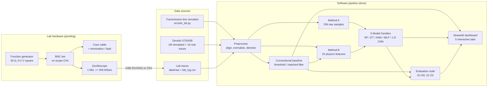
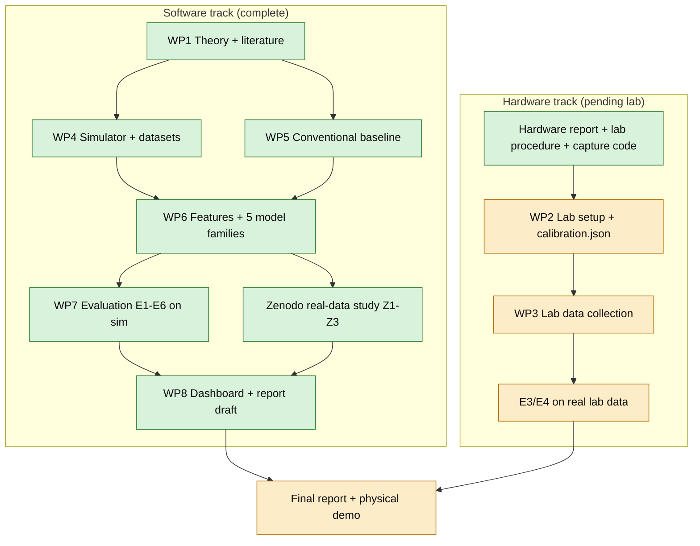
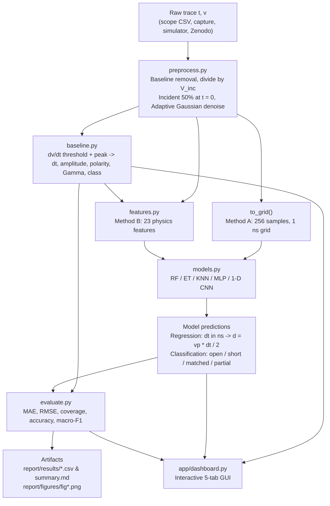
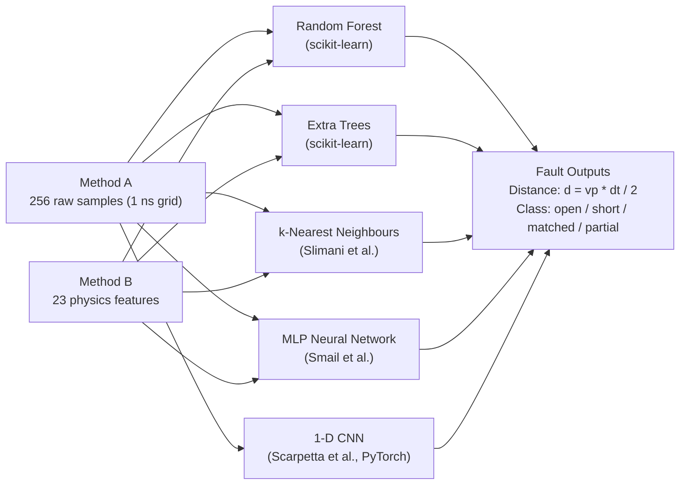
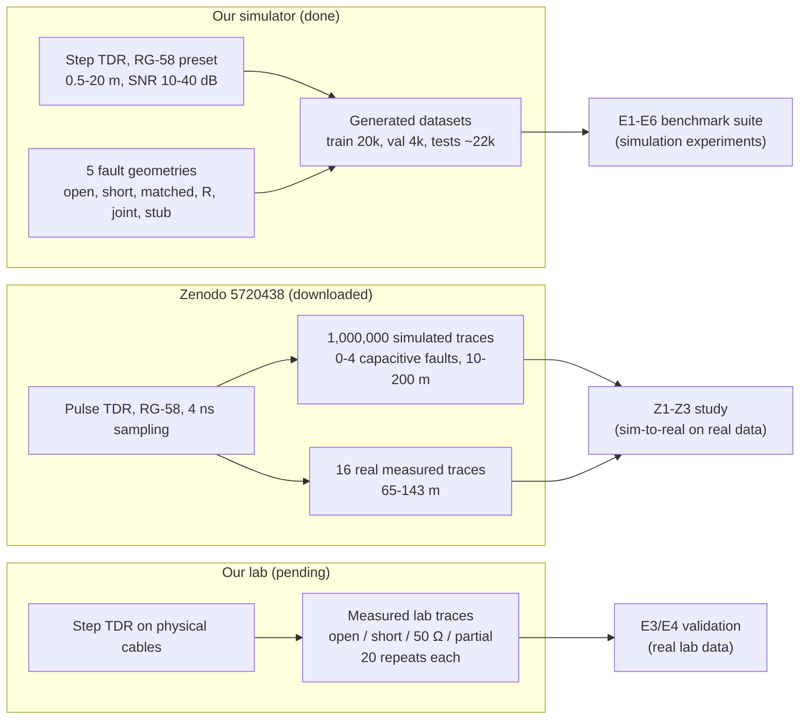
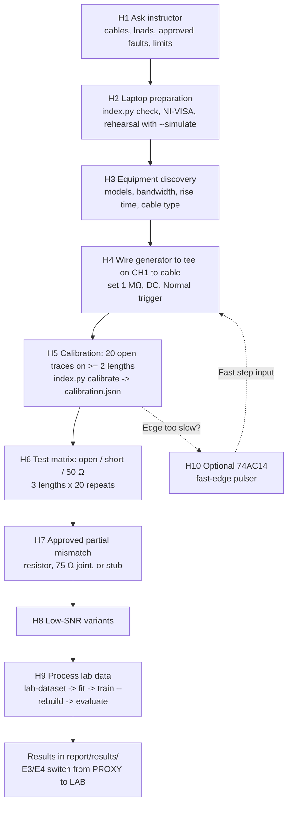
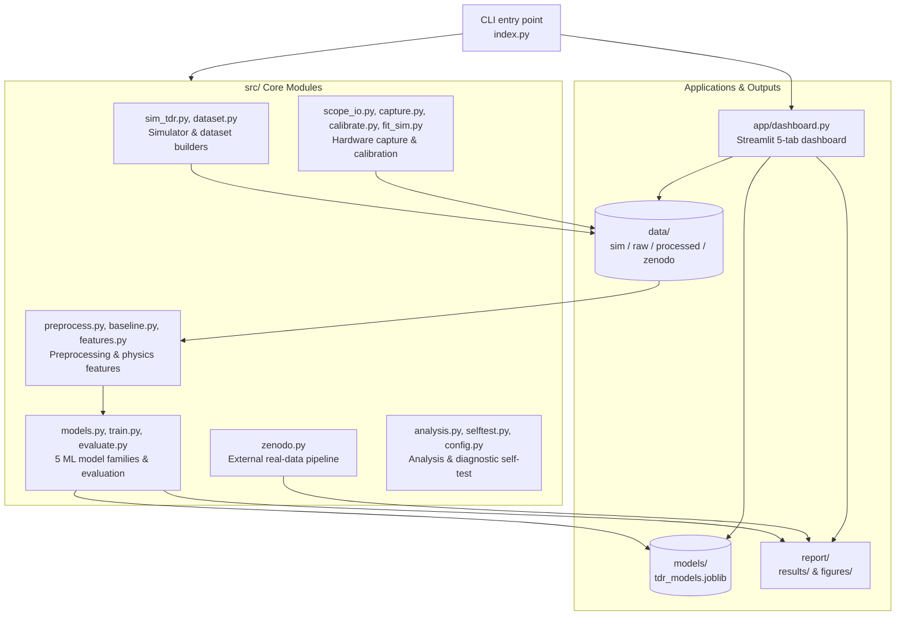

# TDR cable fault detection with physics-informed machine learning

A fast, low-voltage step (or pulse) goes into a coaxial cable. An oscilloscope at a BNC tee records the incident and reflected waves, and every impedance discontinuity sends back an echo. The echo's delay Δt gives the fault distance:

$$d = \frac{v\_p,\Delta t}{2} \qquad\qquad \Gamma = \frac{Z\_L - Z\_0}{Z\_L + Z\_0}$$

The project compares a **conventional signal-processing baseline** with **five model families taken from the literature**: Random Forest, Extra Trees, k-nearest neighbours, an MLP neural network and a 1-D CNN. The models are trained on a physics-based transmission-line simulator and tested on simulation, on lab-like artifacts and on **real measured traces** from a published dataset. A Streamlit dashboard shows everything.

> **Status, Nov 2026:** the **software is complete and runs without any hardware**. The **hardware part (lab session) is still to do**. See [docs/PROJECT\_STATUS.md](docs/PROJECT_STATUS.md) for the full done / pending list and [hardware/HARDWARE\_REPORT.md](hardware/HARDWARE_REPORT.md) for the lab plan.

---

## Contents

1. [System overview](#1-system-overview)
2. [Project status at a glance](#2-project-status-at-a-glance)
3. [Quick start](#3-quick-start)
4. [Software pipeline](#4-software-pipeline)
5. [Models (from the literature)](#5-models-from-the-literature)
6. [Data sources](#6-data-sources)
7. [Experiments and key results](#7-experiments-and-key-results)
8. [Hardware workflow](#8-hardware-workflow)
9. [Command reference](#9-command-reference)
10. [Repository layout](#10-repository-layout)
11. [Documentation index](#11-documentation-index)
12. [Limitations](#12-limitations)
13. [Credits and licences](#13-credits-and-licences)

---

## 1. System overview



---

## 2. Project status at a glance



Green means done, orange means pending (needs the lab). Details are in [docs/PROJECT\_STATUS.md](docs/PROJECT_STATUS.md).

---

## 3. Quick start

Windows, Python 3.13. Every command is run from the project folder.

```powershell
python -m venv .venv
.venv\Scripts\python -m pip install -r requirements.txt
.venv\Scripts\python -m pip install torch --index-url https://download.pytorch.org/whl/cpu   # 1-D CNN

.venv\Scripts\python index.py check          # packages, VISA, calibration, models
.venv\Scripts\python index.py train          # simulate 20k + 4k traces, fit all families (~20 min on 16 cores)
.venv\Scripts\python index.py evaluate       # E1-E6 -> report/results, report/figures (~40 min)
.venv\Scripts\python index.py analyze        # localization / detection / latency analysis -> ml_analysis_summary.md
.venv\Scripts\python index.py zenodo all     # 4.18 GB download + real-data study Z1-Z3 (~3 h, CPU)
.venv\Scripts\python index.py dashboard      # opens the dashboard in the browser
.venv\Scripts\python -m pytest -q            # 62 tests, about 1 min (temporary data folder)
.venv\Scripts\python index.py selftest       # every feature end to end in a temp folder -> feature_tests.md
```

To try only one part quickly: `index.py train --families RF ET` trains just the tree models, and `index.py evaluate --quick` uses smaller test sets.

---

## 4. Software pipeline



Design rules (brief §7.5), all enforced in code:

- every trace is normalised by V\_inc;
- the true distance, Γ\_true and attenuation are **never** model inputs;
- hyper-parameters are tuned on the validation set only;
- test sets use separate seeds or separate data blocks.

---

## 5. Models (from the literature)

| Family                     | Where it comes from                                        | Inputs           | Notes                                                     |
| -------------------------- | ---------------------------------------------------------- | ---------------- | --------------------------------------------------------- |
| Random Forest, Extra Trees | project brief                                              | A and B          | feature importances; robust baseline ML                   |
| k-nearest neighbours       | Slimani et al. 2024/2025 (KNN beat a 1D-CNN there)         | A and B          | distance-weighted, scaled inputs                          |
| MLP neural network         | Smail et al. 2011 (NN inverse model trained on simulation) | A and B          | scaled inputs and targets, early stopping                 |
| 1-D CNN (PyTorch)          | Scarpetta et al. 2021, Slimani et al. 2024                 | A (raw sequence) | 4 conv blocks + dense head; multi-task version for Zenodo |
| Conventional baseline      | Shin et al. 2005 (cross-correlation)                       | –                | step data: dv/dt peak; pulse data: matched filter         |



Why each model was chosen, and what was not implemented (the 2-D time-frequency CNN of Chang & Park), is explained in [docs/model\_selection.md](docs/model_selection.md).

---

## 6. Data sources



- **Simulator** (`src/sim_tdr.py`): a frequency-domain lossy, dispersive line with skin and dielectric loss, generator mismatch, scope input capacitance and multiple reflections. A scope model adds jitter, noise, drift and 8-bit quantisation. The brief's simpler analytic model is kept for comparison.
- **Zenodo** (`src/zenodo.py`):
  - 4,180,670,194 bytes, CRC-verified;
  - memory-mapped directly inside the zip, never fully loaded into RAM;
  - labels read with a **restricted unpickler** (no `allow_pickle=True`).
    The targets are reduced to our single-fault framing: distance to the first discontinuity, cable length, and class of the first discontinuity.
- **Lab:** the capture code and procedure are ready; no data yet.

---

## 7. Experiments and key results

| #     | Question                                      | Data                              | Status                      |
| ----- | --------------------------------------------- | --------------------------------- | --------------------------- |
| E1    | Does ML beat the baseline in noise?           | sim, 7 SNR levels                 | done                        |
| E2    | Interpolation / extrapolation over distance   | sim, held-out bands               | done                        |
| E3    | Sim-to-real gap                               | lab (proxy until lab data exists) | proxy done, **lab pending** |
| E4    | Does a little real data help?                 | lab (proxy)                       | proxy done, **lab pending** |
| E5    | Soft faults (small \|Γ\|)                     | sim                               | done                        |
| E6    | Raw samples (A) vs physics features (B)       | sim                               | done                        |
| Z1–Z3 | Held-out sim, noise sweep, **16 real traces** | Zenodo                            | done                        |

**Simulation results** (mixed test set: 6,000 traces, SNR 10–40 dB). Full tables are in [report/results/summary.md](report/results/summary.md).

| Method                      | Faults given a distance | MAE, all of them | MAE on traces the baseline located | Classification accuracy |
| --------------------------- | ----------------------- | ---------------- | ---------------------------------- | ----------------------- |
| Baseline (threshold + peak) | 84.8 %                  | 0.261 m          | 0.261 m                            | 86.1 %                  |
| Extra Trees, features       | 100 %                   | 0.369 m          | **0.187 m**                        | 97.8 %                  |
| Random Forest, features     | 100 %                   | 0.370 m          | 0.190 m                            | 97.6 %                  |
| 1-D CNN, raw samples        | 100 %                   | **0.315 m**      | 0.214 m                            | **98.3 %**              |
| MLP, raw / features         | 100 %                   | 0.439 / 0.508 m  | 0.265 / 0.240 m                    | 97.1 / 96.8 %           |
| KNN, raw / features         | 100 %                   | 0.482 / 0.752 m  | 0.256 / 0.365 m                    | 95.5 / 94.7 %           |

**Main findings:**

- **Noise (E1):** at 10 dB, on the same traces, the CNN errs by 0.30 m and Extra Trees by 0.34 m, against 0.51 m for the baseline. The baseline also gives a distance for only 44% of faults at that level.
- **Soft faults (E5):** at |Γ| = 0.08 and 30 dB, the CNN detects 96% of faults and the baseline 9%.
- **Extrapolation (E2):** every learned model fails beyond the trained distances (1.4–6.5 m MAE), while the baseline holds at 0.38 m. The MLP on features extrapolates best, and the CNN worst.
- **Inputs (E6):** physics features beat raw samples for the tree models and the MLP. KNN works only on raw samples, which contradicts the KNN result reported in the literature for this setting.
- **Sim-to-real proxy (E3/E4):** lab-like artifacts raise every error. Fine-tuning on 149 target traces does not help.
- **Detection:** the 1-D CNN finds 98.1 % of faults with 1.2 % false alarms. The baseline finds 84.6 % with 1.5 % false alarms: it misses weak echoes.
- **Speed:** about 10 ms per trace end to end (front end + best regressor + best classifier) on a laptop CPU.

**Real measured traces** (Zenodo 5720438; 16 traces, 65–143 m cables; models trained on that dataset's simulations only):

- **First-fault distance:** the 1-D CNN errs by 1.23 m on average, against 8.64 m for the matched-filter baseline.
- **Cable length:** Extra Trees on features is within 0.61 m (−2.1 … +1.2 %), against 13.2 m for the baseline.
- **Fault type:** 16/16 for the feature models and the CNN, against 9/16 for the baseline.

Full tables: [report/results/zenodo\_summary.md](report/results/zenodo_summary.md) and `zenodo_results_all_models.csv`.

**In-depth analysis** (error percentiles, worst cases, breakdowns, precision/recall/F1, confusion matrices, misses and false alarms, latency): [docs/ML\_ANALYSIS.md](docs/ML_ANALYSIS.md). **Testing** (19/19 features pass end to end, 62 unit tests, review fixes): [docs/TESTING\_REPORT.md](docs/TESTING_REPORT.md).

Figures: [report/figures/](report/figures/).

---

## 8. Hardware workflow



- **Start here:** [hardware/README.md](hardware/README.md) is the beginner's step-by-step manual: complete parts list with specifications, port-to-port and pin tables, power, assembly, driver set-up, steps S1–S15 in order (what / why / you need / how / done when), troubleshooting and safety.
- **Circuit diagrams and expected outputs for every task** are in [hardware/HARDWARE\_GUIDE.md](hardware/HARDWARE_GUIDE.md): 13 schematics (`hardware/circuits/c*.png`) and 11 expected scope pictures from the simulator (`w*.png`).
- The full plan, with checklists, the time plan, acceptance criteria and risks, is in [hardware/HARDWARE\_REPORT.md](hardware/HARDWARE_REPORT.md).
- The bench instructions and printable log sheet are in [hardware/LAB\_PROCEDURE.md](hardware/LAB_PROCEDURE.md).
- If the generator edge is too slow, [hardware/fast\_edge\_pulser.md](hardware/fast_edge_pulser.md) describes an optional fast step source.

---

## 9. Command reference

| Command                                                                | What it does                                                                                            |
| ---------------------------------------------------------------------- | ------------------------------------------------------------------------------------------------------- |
| `index.py check`                                                       | environment, VISA backends, calibration and model status                                                |
| `index.py simulate --n 2000 [--snr 20] [--model simple] [--artifacts]` | build a labelled synthetic dataset                                                                      |
| `index.py train [--families RF ET KNN MLP CNN] [--rebuild]`            | simulate train/val (cached) and fit all model families                                                  |
| `index.py evaluate [--quick] [--rebuild] [--bundle f]`                 | experiments E1–E6, tables, figures, summary                                                             |
| `index.py analyze [--quick]`                                           | error distributions, breakdowns, detection P/R/F1, confusion, misses/false alarms, latency, model sizes |
| `index.py selftest [--fast] [--keep]`                                  | run every feature for real in a temporary folder → `report/results/feature_tests.md`                    |
| `index.py zenodo download\|prepare\|train\|evaluate\|all`              | external real-data study Z1–Z3                                                                          |
| `index.py dashboard`                                                   | Streamlit dashboard                                                                                     |
| `index.py capture --list`                                              | list oscilloscopes on USB/LAN                                                                           |
| `index.py capture --length 5.02 --termination open --repeats 20 ...`   | capture, save and log lab traces                                                                        |
| `index.py capture --simulate ...`                                      | rehearse a lab session without hardware                                                                 |
| `index.py inspect <file.csv> [--plot]`                                 | read any scope CSV and run the baseline on it                                                           |
| `index.py calibrate`                                                   | vp, offset, rise time, resolution → `data/calibration.json`                                             |
| `index.py fit --file <csv> --length <L> --termination open`            | fit the simulator to a measured trace                                                                   |
| `index.py lab-dataset`                                                 | process all logged lab traces → `data/processed/lab.csv`                                                |

---

## 10. Repository layout



```text
index.py                 single entry point (python index.py help)
src/
  config.py              paths, cable presets, simulation ranges, time grid
  sim_tdr.py             transmission-line simulator + scope model
  preprocess.py          align, normalise, denoise, 256-point grid
  baseline.py            conventional threshold + derivative-peak method
  features.py            Method B features, batch processing
  models.py              model zoo: RF, ET, KNN, MLP, 1-D CNN (PyTorch)
  dataset.py             build / save / load sim and lab datasets
  train.py               grid search on validation, model bundle
  evaluate.py            E1-E6, tables, figures
  zenodo.py              Zenodo download, safe loading, matched-filter baseline, multi-task CNN, Z1-Z3
  scope_io.py            universal scope-CSV reader / writer
  capture.py             PyVISA capture (Rigol, Tektronix, Keysight, Siglent, simulated scope)
  calibrate.py           vp, offset, rise time, resolution from open-circuit traces
  fit_sim.py             fit the simulator to a measured trace
  analysis.py            localization / detection / latency analysis
  selftest.py            end-to-end self-test of every feature
app/dashboard.py         Streamlit + Plotly dashboard (5 tabs)
hardware/                README (start here), HARDWARE_GUIDE, HARDWARE_REPORT, LAB_PROCEDURE, fast_edge_pulser, lab_log_template.csv
  circuits/              schematics c01-c13, expected waveforms w01-w12, wiring pictures p01-p02, make_hardware_figures.py
docs/                    PROJECT_DOCUMENTATION, ML_ANALYSIS, TESTING_REPORT, TECHNICAL_APPENDIX, PROJECT_STATUS, model_selection, theory_sheet, literature, zenodo_check, data_dictionary
presentation/            TDR_Cable_Fault_Detection.pptx / .pdf, diagrams/, build scripts
scripts/                 make_testing_report.py
report/                  report_draft.md, results/ (CSV, summary.md), figures/ (PNG)
data/                    sim/ (generated), external/zenodo_5720438/ (download), raw/ (lab), processed/
models/                  tdr_models.joblib, zenodo_models.joblib (generated)
tests/                   pytest suite
```

---

## 11. Documentation index

| Document                                                        | Content                                                                                         |
| --------------------------------------------------------------- | ----------------------------------------------------------------------------------------------- |
| [docs/README.md](docs/README.md)                                | index of every document in `docs/` and its status                                               |
| [docs/PROJECT\_DOCUMENTATION.md](docs/PROJECT_DOCUMENTATION.md) | the whole project from problem to results, in one document                                      |
| [docs/ML\_ANALYSIS.md](docs/ML_ANALYSIS.md)                     | localization and detection performance in depth (measured)                                      |
| [docs/TESTING\_REPORT.md](docs/TESTING_REPORT.md)               | feature-by-feature testing, review findings and fixes                                           |
| [docs/TECHNICAL\_APPENDIX.md](docs/TECHNICAL_APPENDIX.md)       | formulas, configuration values, file formats, command reference, source references              |
| [presentation/](presentation/)                                  | final presentation (.pptx + .pdf), diagrams, build scripts                                      |
| [docs/PROJECT\_STATUS.md](docs/PROJECT_STATUS.md)               | checklist: completed, pending and blocked tasks                                                 |
| [hardware/README.md](hardware/README.md)                        | **hardware start here**: beginner's step-by-step manual                                         |
| [hardware/HARDWARE\_GUIDE.md](hardware/HARDWARE_GUIDE.md)       | every hardware task: circuit diagram, steps, expected waveform, expected numbers, pass criteria |
| [hardware/HARDWARE\_REPORT.md](hardware/HARDWARE_REPORT.md)     | complete plan for the hardware part                                                             |
| [hardware/LAB\_PROCEDURE.md](hardware/LAB_PROCEDURE.md)         | bench instructions, settings, log sheet, troubleshooting                                        |
| [docs/model\_selection.md](docs/model_selection.md)             | which ML / neural networks and why (literature mapping)                                         |
| [docs/theory\_sheet.md](docs/theory_sheet.md)                   | one-page TDR theory                                                                             |
| [docs/literature.md](docs/literature.md)                        | the five papers: topic and use in the project                                                   |
| [docs/zenodo\_check.md](docs/zenodo_check.md)                   | go/no-go check of the external dataset, and how it is now used                                  |
| [docs/data\_dictionary.md](docs/data_dictionary.md)             | every column of every dataset                                                                   |
| [report/report\_draft.md](report/report_draft.md)               | technical report draft with results and limitations                                             |

---

## 12. Limitations

- **Simulation only so far.** Results on our own setup are simulation-only until the lab session. E3/E4 use a labelled **proxy** set meanwhile.
- **No extrapolation.** Learned models fail outside their training ranges (distance, rise time, cable type). Retrain after calibration.
- **Resolution limit.** Faults closer than Δd\_min ≈ vp·t\_r/2 to the tee merge with the incident edge.
- **Untested drivers.** The scope drivers follow the vendors' manuals but are untested on real instruments. Fall back to CSV export if needed.
- **Narrower Zenodo use.** The Zenodo dataset is used only through our single-fault targets; its multi-fault labels are not exploited.

More detail is in the report draft (§8).

---

## 13. Credits and licences

- External data: M. Scarpetta, M. Spadavecchia, F. Adamo, M. A. Ragolia, N. Giaquinto, *Supplementary material for "Detection and Characterization of Multiple Discontinuities in Cables with Time Domain Reflectometry and Convolutional Neural Networks"*, Zenodo, 2021, doi:10.5281/zenodo.5720438. Licence CC BY 4.0. The authors' trained TensorFlow model in the archive is not used.
- Literature: see [docs/literature.md](docs/literature.md).
