# TDR Cable Fault Detection with Physics-Informed Machine Learning: complete project documentation

This document describes the whole project, from the problem to the current implementation, results and open work. It is written to be read without prior knowledge of the code. Every module, command and number named here exists in this repository. Measured numbers come from the result files cited next to them. Anything not yet measured on real lab hardware is labelled as such.

| Read next | For |
|---|---|
| [README.md](../README.md) | quick start and command reference |
| [hardware/README.md](../hardware/README.md) | step-by-step hardware manual (beginner level) |
| [docs/ML_ANALYSIS.md](ML_ANALYSIS.md) | in-depth localization and detection performance |
| [docs/TESTING_REPORT.md](TESTING_REPORT.md) | feature-by-feature test report, review findings and fixes |
| [docs/PROJECT_STATUS.md](PROJECT_STATUS.md) | checklist of completed, pending and blocked tasks |
| [docs/TECHNICAL_APPENDIX.md](TECHNICAL_APPENDIX.md) | formulas, configuration values, file formats, source references |
| [report/report_draft.md](../report/report_draft.md) | the technical report (academic format) |
| [presentation/](../presentation/) | final presentation (.pptx + .pdf), diagrams, dashboard screenshots |
| [docs/README.md](README.md) | index of every document in `docs/` |

---

## 1. Overview and objectives

**What we build.** A system that finds and classifies faults in a coaxial cable from one time-domain reflectometry (TDR) trace. A function generator sends a voltage step into the cable, and an oscilloscope records the step and its echoes at the cable's input. The software then answers two questions:
- **Detection:** is there a fault, and what kind? It picks one of four classes: open, short, matched (no fault) and partial (resistive load, series or shunt resistor, impedance joint, stub).
- **Localization:** how far from the input is the fault, in metres?

**How.** Two independent methods answer both questions, so they can be compared on identical traces:
1. A **classical baseline**: threshold and derivative-lobe detection, d = vp·Δt/2.
2. **Machine-learning models** trained on physics-based simulations: Random Forest, Extra Trees, k-nearest neighbours, an MLP neural network and a 1-D convolutional neural network. They use two input representations: the raw trace (Method A) and 23 physics features (Method B).

**Objectives** (from the brief, work packages WP1–WP8):

| # | Objective | Where |
|---|---|---|
| O1 | Simulate realistic TDR traces with known labels | `src/sim_tdr.py` (WP4) |
| O2 | A conventional baseline to beat | `src/baseline.py` (WP5) |
| O3 | ML models for distance and fault type; compare raw vs feature inputs | `src/features.py`, `src/models.py`, `src/train.py` (WP6) |
| O4 | Experiments E1–E6: noise, held-out distances, sim-to-lab gap, soft faults, input comparison | `src/evaluate.py` (WP7) |
| O5 | Lab setup, calibration and labelled real data | `src/capture.py`, `src/calibrate.py`, `hardware/` (WP2–WP3) |
| O6 | Interactive demonstrator | `app/dashboard.py` (WP8) |
| O7 | Validate on real measured traces | Zenodo 5720438 via `src/zenodo.py` (extension) |

## 2. Problem statement

Cables fail through breaks (open), crushed or wet insulation (short or low-resistance path), bad connectors (series resistance) and wrong-impedance repairs. Finding the fault without digging up or unreeling the cable needs a method that works from one end. A TDR trace contains the answer: the echo's **delay** gives the distance and its **sign and size** give the fault type. Reading it reliably is still hard:
- **Noise.** Small echoes from partial faults sink into noise. The threshold has to be low enough to see them and high enough to ignore noise.
- **Edge speed.** A slow generator edge (5–15 ns on lab function generators) smears echoes. Faults closer than about vp·t_r/2 (≈ 0.4–1.5 m) merge with the incident step.
- **Cable loss and dispersion.** The echo is smaller and slower than the incident step, which biases timing and amplitude.
- **Real instruments.** Ringing, adapter reflections, trigger jitter, 8-bit quantisation and baseline drift all add structure that a simple threshold mistakes for faults.

**Question studied:** can ML models trained on physics simulations locate and classify faults more reliably than a classical threshold method, especially at low SNR and for weak faults? Do they still work on real measurements (the sim-to-real gap)?

## 3. Existing methods and their limitations

| Method | How it works | Limitation that motivates this project |
|---|---|---|
| Manual reading of the scope screen | operator finds the echo and measures Δt with cursors | slow, subjective, impossible for small echoes in noise |
| Threshold / peak detection (our baseline) | first derivative lobe above a noise-based threshold | misses weak echoes at low SNR; ringing triggers false early detections; no learning from data |
| Commercial TDR instruments | dedicated fast-edge hardware + vendor software | expensive; closed algorithms; not available in a student lab |
| Matched filtering / cross-correlation (Shin et al. 2005) | correlate the trace with the expected echo shape | needs a known pulse shape; still a threshold at the end (used as our Zenodo baseline) |
| Published ML on TDR (Scarpetta 2021, Slimani 2024/25, Smail 2011, Chang & Park 2019) | CNN / KNN / neural inverse models on simulated or measured traces | each paper uses its own data and set-up; our project compares five families and two inputs against a classical baseline on identical traces, then tests the same chain on real measurements |

## 4. Proposed solution

1. **Physics first.** A frequency-domain transmission-line simulator reproduces the measurement chain: generator Rs, cable loss, every fault type and the scope input. It produces unlimited labelled traces.
2. **One preprocessing chain for everything.** Simulated and measured traces pass through the same align → normalise → denoise code, so the models see the same kind of input in both cases.
3. **Two inputs × five model families**, all selected by a validation grid search and compared with the baseline on the same held-out traces, so the comparison is fair.
4. **Calibration** (vp, fixture offset t0, rise time, V_inc) ties the simulation to the real setup. The simulator is re-centred on the measured values before retraining.
5. **External real data** (Zenodo 5720438, 16 measured traces + 1 M simulated) tests the method on real measurements before our own lab session.
6. **Tooling for the lab:** automatic scope capture with labelled logging, a universal CSV reader, a live quick check, and beginner-level hardware documentation with circuits and expected waveforms.

## 5. System architecture

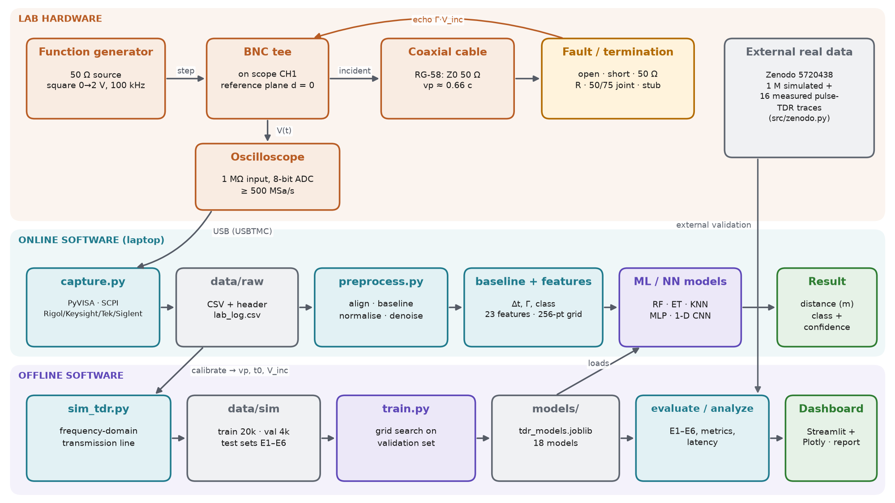

The system has three layers:
- **Lab hardware** produces the signal: generator → tee → cable → fault, with the scope on the tee.
- **Online software** handles each measured trace: capture → storage → preprocessing → baseline + features → models → result.
- **Offline software** simulates, trains and evaluates: simulator → datasets → training → model bundle → evaluation → dashboard and report.

Calibration links the layers: it is measured on the hardware and re-centres the simulator.

## 6. Hardware architecture

The full beginner manual (component list with specifications, port-to-port tables, power, assembly, ordered steps, troubleshooting, safety) is [hardware/README.md](../hardware/README.md). In short:

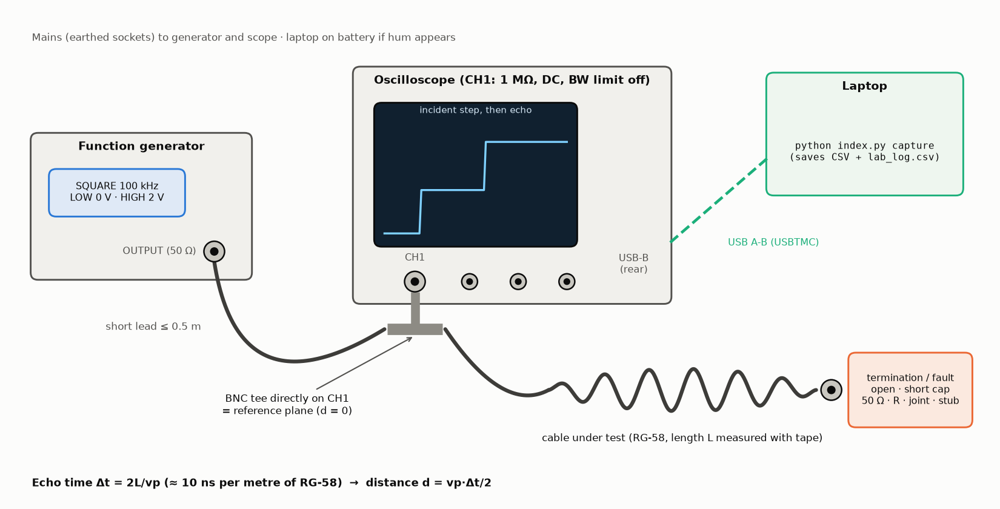

| Component | Role | Key specification |
|---|---|---|
| Function generator | incident step | 50 Ω output, square 0 → 2 V, 100 kHz (5 µs high ≫ round trip) |
| BNC tee on scope CH1 | joins generator, cable and scope; reference plane d = 0 | directly on the input, short (≤ 0.5 m) generator lead |
| Coaxial cables | lines under test | RG-58, Z0 = 50 Ω, VF ≈ 0.66; 2 / 5 / 10 m |
| Terminations and fault fixtures | the "faults" | open, short cap, 50 Ω, 22/100 Ω loads, series box, shunt tee, 50/75 Ω joint, open stub |
| Oscilloscope | records V(t) at the tee | ≥ 100 MHz, ≥ 500 MSa/s, 1 MΩ, USBTMC |
| Laptop | capture, processing, models, dashboard | Python 3.11+, NI-VISA or pyvisa-py |
| Optional 74AC14 pulser | faster edge (≈ 2–3 ns) | 5 V, 4 × 180 Ω outputs ≈ 48 Ω source |

The project has no microcontroller and no firmware to write. Circuit diagrams for every set-up (c01–c13) and the simulated expected scope pictures (w01–w12) are in [hardware/circuits/](../hardware/circuits/).

## 7. Software architecture

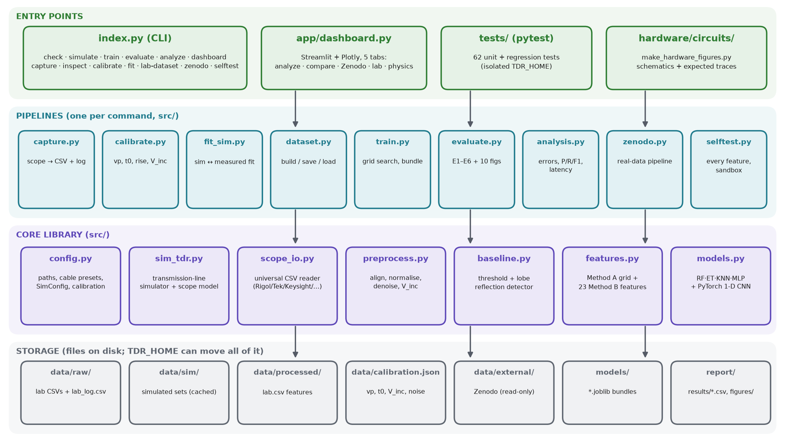

| Module | Purpose | Main inputs → outputs |
|---|---|---|
| `index.py` | single CLI entry point: check, simulate, train, evaluate, analyze, dashboard, capture, inspect, calibrate, fit, lab-dataset, zenodo, selftest | command line → runs a pipeline; bad inputs give one-line errors (`TDR_DEBUG=1` shows tracebacks) |
| `src/config.py` | paths (moveable with `TDR_HOME`), cable presets (RG-58/174/316/59), `SimConfig` ranges, calibration loader, config fingerprint for caches | `data/calibration.json` → merged settings |
| `src/sim_tdr.py` | transmission-line simulator + scope model | random or explicit parameters → (t, v) traces + labels |
| `src/scope_io.py` | read any scope CSV (Rigol, Tektronix, Keysight, Siglent, generic) and our own format | file → `Waveform(t, v, meta)` |
| `src/preprocess.py` | align, baseline-correct, normalise by V_inc (per trace for measurements), denoise, resample to the 256-point grid | (t, v) → `Processed` |
| `src/baseline.py` | classical reflection detector | `Processed` → Δt, d, amplitude, Γ, class |
| `src/features.py` | Method A grid and 23 Method B features; batch processing | `Processed` + baseline → model inputs |
| `src/dataset.py` | build, save and load simulated and lab datasets | traces + labels → CSV + `.npy` (+ raw `.npz`) |
| `src/models.py` | model zoo with one interface: RF, ET, KNN, MLP (scikit-learn), 1-D CNN (PyTorch) | `make_model(task, family, params)` |
| `src/train.py` | simulate train/val sets, grid search on validation, save the bundle; `predict()` for every model | datasets → `models/tdr_models.joblib` |
| `src/evaluate.py` | experiments E1–E6, tables and ten figures | bundle + test sets → `report/results`, `report/figures` |
| `src/analysis.py` | error distributions, breakdowns, detection P/R/F1, confusion, misses/false alarms, latency, model sizes | bundle + test sets → `analysis_*.csv`, `ml_analysis_summary.md`, figures a1–a6 |
| `src/capture.py` | PyVISA drivers (Rigol, Keysight/Agilent, Tektronix, Siglent; SimScope for rehearsal), labelled logging, live quick check | scope → CSV + `lab_log.csv` |
| `src/calibrate.py` | vp and t0 from open traces at ≥ 2 lengths; rise, resolution, V_inc, noise | lab log → `data/calibration.json`, fig0 |
| `src/fit_sim.py` | least-squares fit of the simulator to a measured trace | trace → fitted vp, rise, loss, scope C, Rs, fig5 |
| `src/zenodo.py` | safe download/parsing of Zenodo 5720438, matched-filter baseline, features, RF/ET/KNN/MLP/CNN, Z1–Z3 tests | 4.18 GB archive → `models/zenodo_models.joblib`, `zenodo_*.csv` |
| `src/selftest.py` | runs every feature end to end in a temporary folder and records the results | → `report/results/feature_tests.md` |
| `app/dashboard.py` | Streamlit + Plotly app with 5 tabs: analyze a trace, model comparison, real data, calibration and lab, physics | bundle + results + traces → interactive UI |

**Execution flow of one command** (example: `python index.py inspect trace.csv`):
1. `index.py` dispatches to `cmd_inspect`, inside the CLI error handler.
2. `scope_io.load_waveform` detects the vendor format and returns t, v and metadata.
3. `config.load_calibration` merges `calibration.json` with the defaults.
4. `features.process_one` runs `preprocess_measured` (V_inc per trace), then `baseline.detect` (corrected by t0), then the model inputs.
5. The result is printed (V_inc, rise, noise, Δt, d, amplitude, Γ, class) and optionally plotted.

## 8. Data flow and workflow

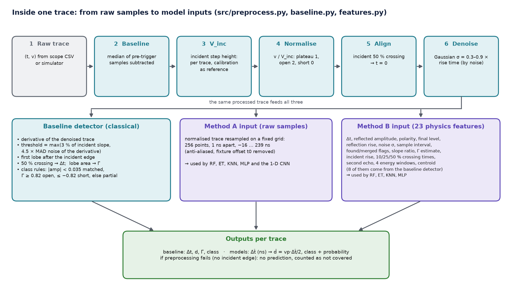

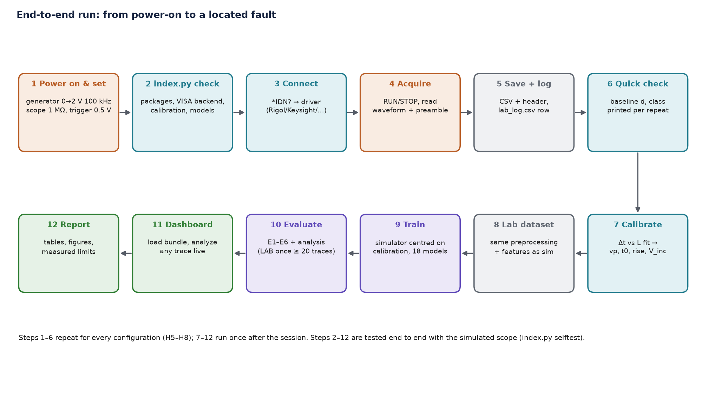

## 9. The simulator (how training data is made)

`src/sim_tdr.py` computes each trace in the frequency domain:
- **Cable:** propagation constant γ(f) = α(f) + jω/vp, with α(f) = α_dc + k_s√f + k_d·f fitted to the datasheet attenuation at 100 MHz and 1 GHz, scaled by a random factor.
- **Fault:** the load seen at distance d is built from the fault kind. End load ZL; series R followed by a matched line; shunt R across a matched line; impedance step to Z2 over length l2; open stub of length l_stub on a tee. The input reflection is transformed back along the cable: Γ_in(f) = Γ_d(f)·e^(−2γd).
- **Source and scope:** the generator EMF with Rs = Z0·(0.92–1.08), and the scope input 1 MΩ ∥ C (8–20 pF) at the tee.
- **Edge:** a Gaussian rise-time filter (2–10 ns, 10–90 %).
- **Time domain:** inverse FFT of the impulse response, then a cumulative sum gives the step response.
- **Scope effects:** sampling at 0.5, 1 or 2 ns; white noise at a target SNR (10–40 dB); trigger jitter (±2 ns); slow baseline drift (≤ 2 % of V_inc); 8-bit ADC quantisation.
- **Random ranges per trace:** vp ±3 % around the nominal or calibrated value, cable loss ×0.7–1.3, partial-fault |Γ| 0.05–0.70, matched loads within ±5 % of Z0, 1–8 m of cable after a mid-line fault, stubs 0.3–3 m.
- **Proxy lab mode** (`--artifacts`) adds adapter reflections, ringing and 1/f noise.

The unit tests check every termination's final level against 1 + Γ and the echo delay against 2L/vp (`tests/test_physics_baseline.py`, selftest F09).

## 10. Localization methodology

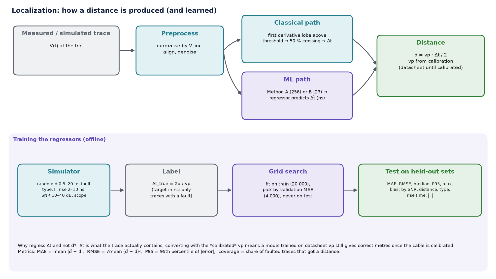

- **Classical:** the first derivative lobe after the incident edge that exceeds the threshold max(3 % of the incident slope, 4.5 × robust noise). Its 50 % crossing gives Δt, and d = vp·Δt/2.
- **ML:** the regressors predict **Δt** in ns from Method A or B; d = vp·Δt/2 with the calibrated vp. They are trained only on traces that contain a fault, with label Δt_true = 2d/vp.
- **Fixture offset:** measured echoes arrive at 2d/vp + t0. t0 (from calibration) is removed from the baseline's times and from both model inputs.

## 11. Detection methodology

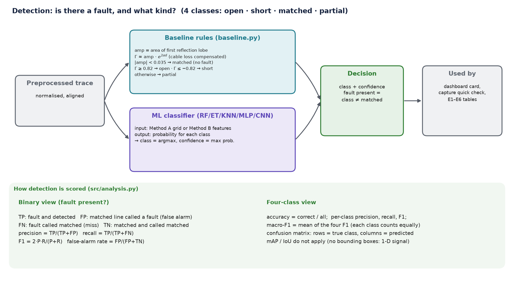

- **Classical:** from the reflection lobe's amplitude and the loss-compensated Γ estimate: |amp| < 0.035 → matched; Γ ≥ 0.82 → open; Γ ≤ −0.82 → short; otherwise partial.
- **ML:** classifiers output a probability for each of the 4 classes. Class = argmax, confidence = the maximum probability.
- **Fault present** = predicted class ≠ matched. This gives the binary detection metrics: precision, recall, false-alarm and miss rates.

## 12. ML/NN models and configuration

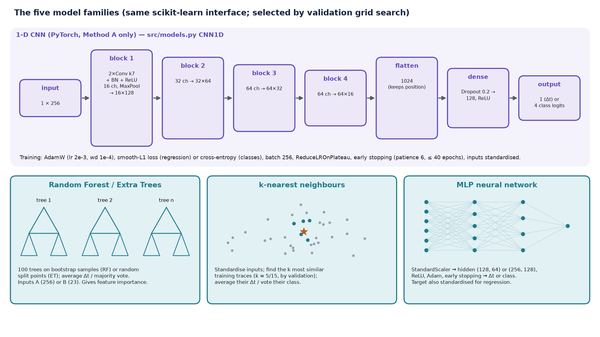

| Family | Inputs | Hyper-parameters searched (validation set) | Library |
|---|---|---|---|
| Random Forest | A, B | max_features ∈ {sqrt, 0.3} (A) or {0.5, 1.0} (B) × min_samples_leaf ∈ {2, 5}; classifiers leaf 1; 100 trees | scikit-learn |
| Extra Trees | A, B | same grid as Random Forest | scikit-learn |
| k-nearest neighbours | A, B | k ∈ {5, 15}, distance weighting, inputs standardised | scikit-learn |
| MLP | A, B | hidden layers (128, 64) or (256, 128), α = 1e-4, Adam, early stopping; inputs and target standardised | scikit-learn |
| 1-D CNN | A | 4 conv blocks (16/32/64/64 channels, k = 7), dense 128, dropout 0.2; AdamW, ≤ 40 epochs, patience 6 | PyTorch (CPU) |

The selected configuration of every stored model, with its size and parameter count, is in `report/results/analysis_model_config.csv`.

## 13. Datasets and preprocessing

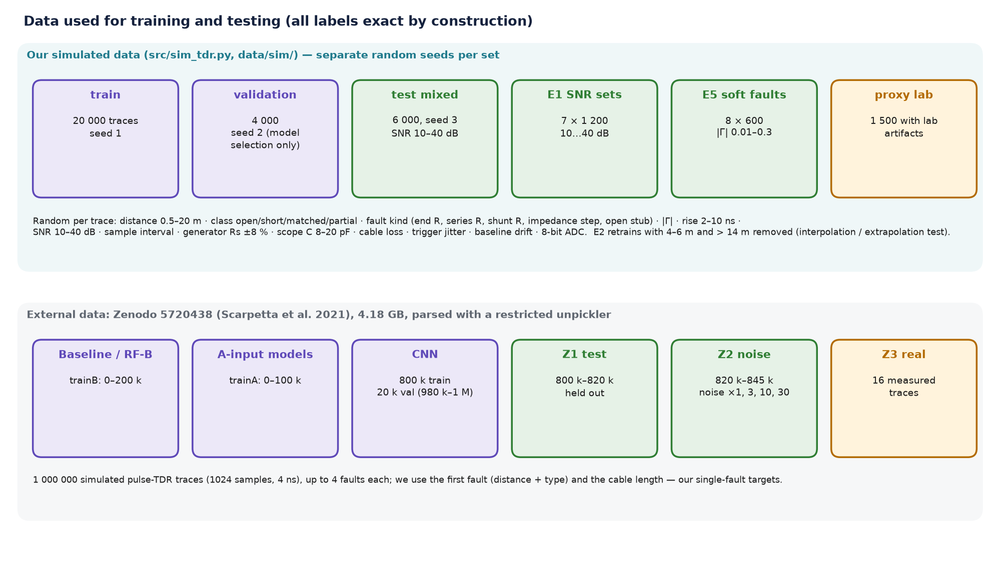

- **Simulated:** train 20 000 (seed 1), validation 4 000 (seed 2), mixed test 6 000 (seed 3), E1 7 × 1 200 (SNR 10…40 dB), E5 8 × 600 (|Γ| 0.01–0.3), proxy-lab 1 500 (with artifacts). Ranges: distance 0.5–20 m, rise 2–10 ns, SNR 10–40 dB, all fault kinds. Cached sets carry a fingerprint of the simulation config, so a changed calibration never reuses stale data.
- **Lab:** every row of `data/raw/lab_log.csv` → `index.py lab-dataset` → `data/processed/lab.csv`. The processing chain is identical, with V_inc per trace and t0 removed.
- **Zenodo 5720438:** 1 000 000 simulated pulse-TDR traces (1024 samples at 4 ns) plus 16 measured traces. Parsed with a restricted unpickler (no code execution) and memory-mapped from inside the zip. Splits are disjoint, and every split draws its own noise realisation.

## 14. Training and validation methodology

- Models are fitted on the training set. **Hyper-parameters are chosen on the validation set only.** The test sets are used once, for reporting.
- Regression target: Δt in ns, on faulted traces only. Classification target: the 4 classes.
- Traces whose preprocessing failed (no incident edge) are excluded from training. At test time they get no prediction and count against coverage.
- E2 retrains with distances 4–6 m and > 14 m removed, to test interpolation and extrapolation. E4 fine-tunes with 10–20 % of the lab (or proxy) data, weighted ×5.
- Metrics: MAE, RMSE, median, P90/P95/P99 and maximum absolute error, bias, share within 0.25/0.5 m, coverage. Accuracy, precision, recall, F1 (per class and macro), confusion matrices, miss and false-alarm rates. Latency per trace. Formulas are in [TECHNICAL_APPENDIX.md](TECHNICAL_APPENDIX.md).

## 15. Hardware–software integration

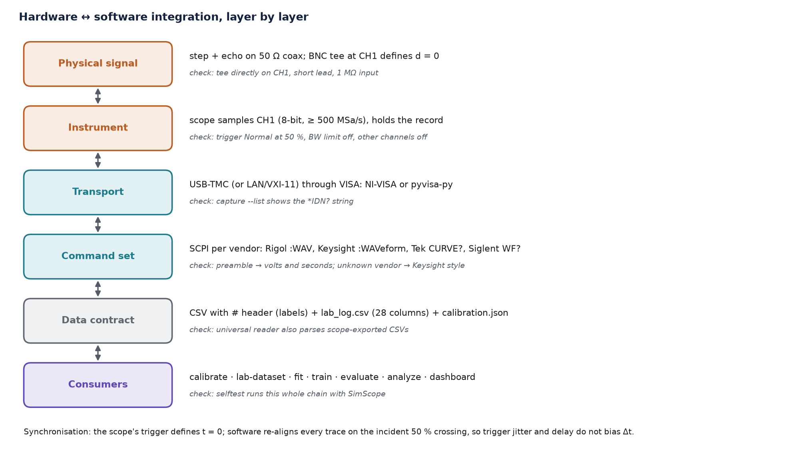

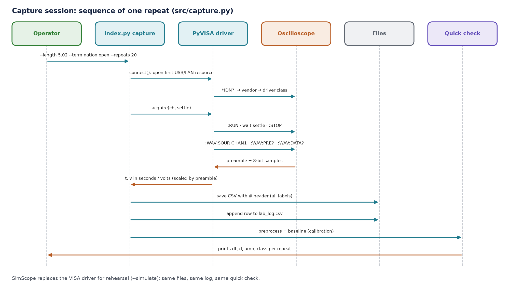

The **data contract** between lab and software has three parts:
- **Each CSV:** samples plus a `#` header holding every label.
- **`lab_log.csv`:** 28 columns, one row per trace, with file paths relative to the log and written portably.
- **`calibration.json`.**

The universal reader also accepts scope-exported CSVs, so a lab where USB capture is not allowed loses nothing. The whole chain capture → calibrate → fit → lab-dataset → train → evaluate → dashboard is exercised end to end with the simulated scope by `index.py selftest`.

## 16. Implementation details worth knowing

- **Reproducibility:** fixed seeds per dataset; selected hyper-parameters are stored in the bundle (`val_table`), together with the forest size, the training-set name and the simulation config.
- **Calibration everywhere:** `load_calibration()` merges `data/calibration.json` with datasheet defaults. `sim_config_from_calibration()` re-centres vp, rise, V_inc and noise ranges on the measured values.
- **Measured-trace normalisation:** V_inc is estimated per trace. The calibrated value is used when the two agree (−20/+25 %), when estimation fails, or when the incident edge is corrupted by an early echo. This handles low-amplitude traces correctly (review finding 1).
- **Isolation:** `TDR_HOME` moves all data, model and report folders. Tests and the self-test run in temporary folders and never touch real results.
- **Security:** downloaded Zenodo files are untrusted. They are parsed with a whitelist unpickler, the archive's TensorFlow model is never loaded, and Python reads them in isolated mode.
- **Performance:**
  - The CNN streams memory-mapped arrays in chunks, so the 800 k × 1024 Zenodo set never sits in RAM.
  - Test sets are cached.
  - For one trace at a time (dashboard), forests and k-NN run single-threaded (`models.set_threads`). That is 4× faster than starting a thread pool: about 10 ms end to end for the best regressor and classifier.

## 17. Testing and validation

See [TESTING_REPORT.md](TESTING_REPORT.md):
- 62 unit and regression tests;
- a 19-feature end-to-end self-test with expected and actual outputs and timings;
- the independent code review: 14 findings, with the fix (or the check) for each and the test that pins it.

## 18. Performance and results

**All numbers are measured.** The full analysis with every table is [ML_ANALYSIS.md](ML_ANALYSIS.md). Labels: [sim] = held-out simulated traces, [real] = 16 measured traces from Zenodo 5720438, [proxy] = simulation with lab artifacts. Our own lab traces are pending.

| Result | Classical baseline | Best ML / NN | Source |
|---|---|---|---|
| Faults given a distance [sim, 4 513 faults] | 84.8 % | 100 % (all models) | `analysis_localization.csv` |
| Distance MAE, same traces for all [sim] | 0.261 m | **0.187 m** (Extra Trees, features) | same |
| Distance MAE / P95, every fault [sim] | – (no answer for 15 %) | **0.315 m / 0.70 m** (1-D CNN) | same |
| Distance MAE at 10 dB, same traces [sim] | 0.51 m (locates 44 %) | 0.30 m (CNN), 0.34 m (ET-B) | `e1_snr_sweep.csv` |
| Fault present: recall / false alarms [sim] | 84.6 % / 1.5 % | **98.1 % / 1.2 %** (CNN) | `analysis_detection_binary.csv` |
| Fault class: accuracy / macro-F1 [sim] | 0.861 / 0.860 | **0.983 / 0.983** (CNN) | `classification.csv` |
| Weak fault \|Γ\| = 0.08 detected at 30 dB [sim] | 9 % | 96 % (CNN), 88 % (ET-B) | `e5_soft_faults.csv` |
| Beyond the trained distances (E2) [sim] | **0.38 m** | 1.4–6.5 m (no extrapolation) | `e2_heldout_distances.csv` |
| Sim-to-lab, same traces [proxy] | 0.70 m | 0.25–0.38 m; fine-tuning +149 traces: ≤ 0.05 m change | `e3_e4_sim_to_lab.csv` |
| First-fault distance [real, 16 traces] | 8.64 m | **1.23 m** (1-D CNN) | `zenodo_results_all_models.csv` |
| Cable length 65–143 m [real] | 13.16 m | **0.61 m**, −2.1…+1.2 % (ET-B) | same |
| First-fault type [real] | 9/16 | 16/16 (feature models, CNN) | same |

**Achievements:**
- A complete, tested pipeline from oscilloscope to located fault.
- ML models that, on the same traces, cut localization error by about 28 % against a strong classical baseline. They detect faults with 2–3× smaller |Γ| and still answer the 15 % of faults the baseline misses.
- The same approach generalises to real measured traces from another lab (Zenodo).

**Honest negatives:**
- The learned models cannot extrapolate beyond their training distances.
- They are not robust to noise levels far above training on the pulse data.
- Fine-tuning on 149 proxy traces did not close the proxy sim-to-lab gap.
- The 16 real traces are a small sample.

## 19. Limitations

- **No real lab data of our own yet.** The E3/E4 sim-to-lab results use a proxy set (simulation + artifacts) until the lab session (hardware steps S1–S14).
- **Resolution:** faults closer than ≈ vp·t_r/2 merge with the incident edge, and no model can separate them reliably.
- **Extrapolation:** trees, KNN and the CNN cannot predict distances outside the training range (E2), so the training range must cover the cables used.
- **Very weak faults (|Γ| < 0.05)** at 30 dB are detected inconsistently by every method (E5).
- **Simulation fidelity:** connectors, the scope front end and generator overshoot are modelled only approximately. The Zenodo test shows a real sim-to-real gap.
- **Noise robustness:** models trained at one noise level degrade beyond it. On the Zenodo pulse data, raw-input models collapse at 3× the training noise, and at 10–30× the matched filter is the most robust.
- **Worst cases:** when a trace carries no usable echo, the regressors fall back to a mid-range guess instead of abstaining.
- **Zenodo KNN-A** stores 100 k raw traces for each of three targets (large model file). Fine for evaluation, not for deployment.

## 20. Future improvements

Domain randomisation, noise augmentation, matched-load reference subtraction, a hybrid rule (ML inside its trained range, baseline outside), a confidence threshold so the models can abstain, the fast-edge pulser, a second cable type, multi-fault outputs, a compact Zenodo k-NN, and fine-tuning on our own lab data. See [PROJECT_STATUS.md](PROJECT_STATUS.md) P3.
