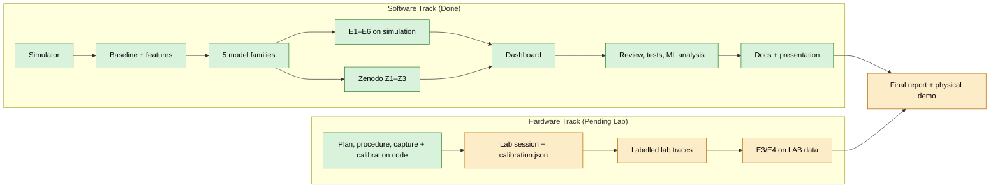

# Project status: done and pending

*Last updated: 6 Nov 2026 (after the code review, the full self-test and the final Zenodo run).* In one line: **the software is complete, reviewed and tested (62 unit tests, 19/19 features pass end to end), with simulation and real-trace (Zenodo) results measured; the hardware/lab part, which the plan calls the top-priority experimental activity, has not started.**

---

## 1. Progress against the working plan

| Plan section | Done | Pending | Progress |
|---|---|---|---|
| 1. EM and transmission-line basics | Theory sheet; d = vp·Δt/2 and Γ in code; Γ calculator and bounce diagram in the dashboard | – | **100 %** |
| 2. Lab arrangement and calibration | Hardware report, lab procedure, PyVISA capture (4 vendors), calibration code; full rehearsal on a simulated scope | Lab session, open/short/matched traces, vp from a cable of known length, real `calibration.json`, setup photo | **~30 %** (preparation only) |
| 3. Data collection and cleaning | Loading (any scope CSV), time alignment, noise reduction, visualisation, feature extraction; log format with sampling interval, cable, setup, reference distance | Recording repeated lab waveforms | **~50 %** |
| 4. Simulation and datasets | Transmission-line simulator (positions, Γ, attenuation, noise); 20k / 4k / ~22k labelled traces; simulator-to-trace fitting tool | Fit the simulator parameters to *our* measured traces | **~90 %** |
| 5. Baseline and ML models | Threshold / peak / delay baseline; RF and Extra Trees on samples and features; classification; extra families from the literature (KNN, MLP, 1-D CNN) | Classification on real lab data (plan: "if enough labelled measurements") | **100 %** on simulation |
| 6. Evaluation and comparison | MAE, RMSE, percentiles, worst cases, accuracy, precision, recall, F1, confusion matrices, misses/false alarms, latency (`docs/ML_ANALYSIS.md`); noise levels, fault locations, fault types; held-out test sets; **16 real Zenodo traces** | Conventional vs ML on our own lab data | **~85 %** |
| 7. Demonstration and deliverables | Dashboard (waveform, detected reflection, predicted distance, comparison with the baseline); report draft; presentation (.pptx/.pdf); full documentation and testing report | Experimental setup deliverable, final report with lab numbers, demo rehearsal | **~75 %** |

**Deliverables (brief §10):**
- 6 of 10 done: simulation code, baseline, feature/training code, trained model, evaluation plots, dashboard.
- 2 partly done: labelled dataset (no lab part yet), report (draft).
- 2 not started: setup with `calibration.json`, demo.

That is about **75 % overall**; everything not done needs the lab.

**Timeline:** the software parts of weeks 1–4 are done. The lab parts of weeks 1–2 (calibration, data collection) are not. This is the plan's own fallback ("simulation and baseline first"), so the next step is physical validation.

## 2. Direction check against the abstract

| The abstract promises | Where we are | On track? |
|---|---|---|
| Physics-based ML for TDR fault detection and location | Simulator-trained models with physics features; baseline from transmission-line theory | Yes |
| Coaxial cable, function generator, oscilloscope, low-voltage pulse | Procedure, settings and capture code ready | Yes, needs the lab session |
| Known end conditions, approved discontinuities at known positions | Test matrix and approved-discontinuity options planned (resistor, 75 Ω joint, stub) | Yes, needs instructor approval and the lab |
| Simulation for many positions, impedances and noise levels | Done | Yes |
| Conventional threshold/peak reference first, then RF/ET | Done, in that order | Yes |
| Classification where possible | Done on simulation (98.3 % best) and on the 16 real traces (16/16 first-fault type) | Yes; lab classification pending |
| MAE, RMSE and classification metrics | Done | Yes |
| Calibration, measurement noise, sim-to-lab generalisation | Noise: done (E1, Z2). Calibration: code ready and rehearsed (vp within 0.9 % on the simulated scope). Generalisation: proxy set done; **16 real Zenodo traces done** (CNN first fault 1.2 m vs baseline 8.6 m); **our own lab data missing** | Partly; the main open risk |
| Low-cost prototype and dashboard | Dashboard done; optional 74AC14 pulser designed | Yes |
| Practical limits from the cable and instrument bandwidth | Resolution limit and dispersion bias of vp documented (vp reads ~0.9 % low with timing calibration) | Partly; real numbers need our equipment |

**Points to watch:**
- **Scope grew beyond the plan.** KNN, MLP, the 1-D CNN and the Zenodo study come from the literature. They strengthen the comparison, but the report should keep RF/ET vs the baseline as the main storyline and present the rest as extensions.
- **Step vs pulse.** The plan says "low-voltage pulse". Our lab procedure uses a long square wave (step TDR), which is a valid pulse whose width exceeds the round trip, and the step pipeline is built for it. Short-pulse handling exists only in the Zenodo module. If the instructor requires narrow pulses, pending item P2-4 applies.
- **Physical validation** is the plan's top priority and is still at zero. Everything else is ahead of schedule.

---

## 3. Done so far (detail)

### 3.1 Software
- **Simulator** (`src/sim_tdr.py`):
  - frequency-domain lossy, dispersive line: skin and dielectric loss, generator mismatch, scope capacitance, multiple reflections;
  - five fault geometries;
  - scope model: jitter, noise at a chosen SNR, drift, offset, 8-bit ADC;
  - the brief's simple model is kept for comparison;
  - physics checked by tests.
- **Preprocessing and baseline** (`src/preprocess.py`, `src/baseline.py`):
  - alignment at the incident 50% crossing, normalisation by V_inc, adaptive denoising;
  - dv/dt threshold with noise-robust lobe detection, 50%-to-50% Δt, loss-compensated Γ, classification, and a fallback for edges that merge with the incident edge.
- **Features:** 23 physics features (Method B) and a 256-sample grid (Method A).
- **Model zoo** (`src/models.py`, rationale in `docs/model_selection.md`): Random Forest, Extra Trees, KNN, MLP, and a PyTorch 1-D CNN that streams memory-mapped arrays.
- **Training** (`src/train.py`): grid search on validation only; regression of Δt and 4-class classification. Bundle: 157 MB.
- **Evaluation** (`src/evaluate.py`): E1 SNR sweep, E2 held-out distances, E3/E4 sim-to-lab (proxy), E5 soft faults, E6 A vs B; ten figures (`fig1`–`fig10`) and `report/results/summary.md`.
- **Zenodo real-data study** (`src/zenodo.py`):
  - 4.18 GB archive downloaded and CRC-verified;
  - labels read with a restricted unpickler; data memory-mapped inside the zip;
  - time axis fitted from data (vp = 1.9686×10⁸ m/s);
  - matched-filter baseline;
  - RF/ET/KNN/MLP on 200k feature rows and 100k raw traces;
  - multi-task CNN on all 800k training traces;
  - Z1 held-out simulation, Z2 noise sweep, **Z3 on the 16 real traces**.
- **Hardware-side software:**
  - universal scope-CSV reader;
  - PyVISA capture (Rigol, Tektronix, Keysight, Siglent, simulated scope);
  - lab log, calibration, simulator-to-trace fitting, lab dataset builder.
- **Dashboard:** five tabs (Analyze trace, Model comparison, Real data (Zenodo), Calibration & lab, Physics); single-threaded inference per trace (about 10 ms for the best two models).
- **In-depth analysis** (`src/analysis.py`, `index.py analyze`): error percentiles and worst cases, breakdowns by fault type / distance / SNR / rise time / |Γ|, binary and per-class detection metrics, confusion matrices, misses and false alarms, latency, model sizes → `docs/ML_ANALYSIS.md`.
- **Code review round (6 Nov):** 14 findings handled (`docs/TESTING_REPORT.md` §3). Main fixes:
  - V_inc estimated per measured trace (low-amplitude traces were misclassified);
  - fixture offset t0 removed from both model inputs;
  - portable lab-log paths;
  - failed traces no longer encoded like shorts;
  - dataset caches keyed by the simulation config;
  - tests isolated with `TDR_HOME`;
  - CLI-wide error handler;
  - per-split Zenodo noise seeds.
- **Tests:**
  - 62 pytest tests (16 of them regression tests for the review findings), all passing.
  - `index.py selftest` runs all 19 features for real in a temporary folder: 19/19 Pass.
- **Documentation and presentation:** `docs/PROJECT_DOCUMENTATION.md`, `ML_ANALYSIS.md`, `TESTING_REPORT.md`, `TECHNICAL_APPENDIX.md`; `presentation/` (95-slide deck + PDF, 12 diagrams, dashboard screenshots).

### 3.2 Hardware preparation (no lab time used yet)
- `hardware/README.md` (**start here**): beginner's manual with the complete parts list and specifications, port-to-port and pin tables, power, assembly, driver set-up, ordered steps S1–S15 (what / why / you need / how / done when), troubleshooting and safety; two wiring pictures (`hardware/circuits/p01`, `p02`).
- `hardware/HARDWARE_GUIDE.md`: every hardware task with its **circuit diagram** (13 schematics in `hardware/circuits/c*.png`), steps, **expected scope waveform** from the simulator (11 plots, `w*.png`), expected numbers and pass criteria. Regenerate with `python hardware/circuits/make_hardware_figures.py`.
- `hardware/HARDWARE_REPORT.md`: complete hardware plan (H1–H10).
- `hardware/LAB_PROCEDURE.md`: bench settings and printable log sheet.
- `hardware/fast_edge_pulser.md`: optional pulser design.
- `hardware/lab_log_template.csv`: the log format the software reads.
- Rehearsal on the simulated scope (self-test F02–F06): capture → log → calibrate → fit → lab dataset all work. 50%-timing calibration read vp 0.86 % low (dispersion); the full simulator fit got within 0.4 % (1.972 vs 1.979 ×10⁸ m/s, RMSE 0.024).

### 3.3 Results available now (`report/results/summary.md`, `docs/ML_ANALYSIS.md`)
Simulation:
- **Distance:** on the traces the baseline locates, Extra Trees and RF on features cut the error by about 28 % (0.26 → 0.19 m; P95 0.61 → 0.46 m). The baseline gives no distance for 15 % of faults; the models answer all.
- **1-D CNN:** lowest all-trace error (0.32 m, P95 0.70 m); best detection (98.1 % of faults found, 1.2 % false alarms, vs 84.6 % / 1.5 % for the baseline) and classification (98.3 % vs 86.1 %); best at low SNR and on soft faults (96 % detected at |Γ| = 0.08, baseline 9 %).
- **Extrapolation:** every learned model fails beyond the trained distances; the baseline does not.
- **KNN:** does not reproduce its literature advantage.
- **Fine-tuning:** 149 proxy traces did not help (≤ 0.05 m change).
- **Speed:** about 10 ms per trace end to end on a laptop CPU.

Real measured traces (Zenodo, 16 traces):
- **First fault:** CNN 1.23 m vs matched-filter baseline 8.64 m.
- **Cable length:** Extra Trees on features 0.61 m (−2.1 … +1.2 %) vs 13.2 m.
- **First-fault type:** 16/16 vs 9/16.
- **Noise:** raw-input models collapse at 3× the training noise. Extra Trees on features degrades gracefully, and the matched filter is the most robust at 10–30× noise.

---

## 4. All pending items

Priority: **P1** blocks a deliverable or a core claim of the abstract; **P2** is needed for the final submission; **P3** is optional.

### P1: physical validation (team, in the lab), per `hardware/HARDWARE_REPORT.md`
| # | Item | Plan / abstract link | Output |
|---|---|---|---|
| P1-1 | Instructor answers: cables, loads, **approved discontinuities and their positions**, voltage limits, USB access, report/demo format, **step (long square wave) or narrow pulse** | plan §2, abstract | answers recorded in the hardware report §3.1 |
| P1-2 | Lab laptop: NI-VISA, `index.py check`, rehearsal with `capture --simulate` | plan §2 | working capture |
| P1-3 | Equipment discovery: scope/generator models, bandwidth, rise time, cable type | abstract (instrument-bandwidth limits) | table §5.1 of the hardware report |
| P1-4 | Build the setup per the manuals and safety rules; photo and diagram | plan §2, deliverable | setup photo + diagram |
| P1-5 | Calibration: open-circuit traces on ≥ 2 known lengths, matched trace; `index.py calibrate` | plan §2 (vp from a known-length cable) | `data/calibration.json`, `fig0` |
| P1-6 | Test matrix: open / short / matched × 3 lengths × 20 repeats | plan §3 | ≈ 180 logged traces |
| P1-7 | Approved discontinuity at known positions, 20 repeats each | plan §3, abstract | partial-mismatch traces |
| P1-8 | Low-SNR variants (lower amplitude, no averaging) | plan §6 (noise levels) | 40–60 traces |
| P1-9 | Data quality check and backup before leaving | – | hardware report §7 checklist ticked |
| P1-10 | Verify the scope driver on the real instrument (or use CSV export) | plan §3 | first good capture |

### P1: software steps that need the lab data
| # | Item | Plan / abstract link |
|---|---|---|
| P1-11 | `index.py lab-dataset`: build the labelled lab dataset | plan §3, deliverable |
| P1-12 | `index.py fit` on measured traces: **adjust the simulation parameters to the measured traces** | plan §4 |
| P1-13 | `index.py train --rebuild`: simulator re-centred on the calibration, models retrained | plan §4–5 |
| P1-14 | `index.py evaluate`: E3/E4 switch from PROXY to LAB; **conventional vs ML on real data** | plan §6, abstract (sim-to-lab generalisation) |
| P1-15 | Classification metrics on lab data (if enough labelled traces) | plan §5–6 |
| P1-16 | Measured practical limits: rise time, Δd_min, attenuation, vp timing bias, for our cable and instruments | abstract (last sentence) |

### P2: software and documents still to finish
| # | Item | Status / note |
|---|---|---|
| P2-1 | Finish the Zenodo run | **DONE** (6 Nov): CNN 6 epochs (val MAE 5.4 → 2.9 m); Z1–Z3 re-evaluated with independent test noise; seed and noise checks in `report/results/zenodo_seed_check.csv`, `zenodo_noise_check.csv` |
| P2-2 | Put the Zenodo numbers into the README, `model_selection.md`, report §6.8 and this file | **DONE**: real traces: CNN first fault 1.23 m, ET-B length 0.61 m, baseline 8.6 / 13.2 m |
| P2-3 | Re-check the "lengths read 1–4% long on real Zenodo traces" statement in the hardware report §8 against the final Z3 results | **DONE, corrected**: the baseline reads a median +3.2 % (outliers to +145 %); ET-B −2.1 to +1.2 % |
| P2-4 | **Narrow-pulse support in our own pipeline**, needed only if the instructor requires short pulses instead of a long square wave: pulse width in the simulator, pulse-mode preprocessing, and reuse of the matched-filter baseline from `src/zenodo.py` | depends on P1-1 |
| P2-5 | Technical report: §3 setup and calibration, §6.4 real E3/E4, Figure 0 and Figure 5 with real data, limitations with measured numbers, keep RF/ET vs baseline as the main storyline, format per the instructor | after P1 |
| P2-6 | Demonstration: script and rehearsal (dashboard Analyze tab with a live or saved lab trace, then the Model comparison and Real data tabs); optional screen recording as a backup | after P1-6 |
| P2-7 | Labelled-dataset deliverable: export lab traces + `lab.csv` + data dictionary as one folder | after P1-11 |
| P2-8 | Trained-model deliverable: retrained bundle after calibration; consider a smaller bundle for submission (157 MB now) | after P1-13 |

### P3: optional improvements
| # | Item | Why |
|---|---|---|
| P3-1 | Domain randomisation (train with the lab-artifact model on) | shrink the sim-to-lab gap |
| P3-2 | Matched-load reference subtraction in the baseline | cancel generator ringing (main proxy failure) |
| P3-3 | Hybrid decision: ML inside the trained range, baseline outside | trees and the CNN cannot extrapolate (E2) |
| P3-4 | Fast-edge pulser (H10), with instructor approval | better resolution on short cables |
| P3-5 | Second cable type (e.g. RG-174 or RG-59) | show the effect of cable characteristics |
| P3-6 | Multi-fault outputs on the Zenodo data | uses the dataset's full labels |
| P3-7 | 2-D time-frequency CNN (Chang & Park 2019) | literature completeness; not needed for step/pulse TDR |
| P3-8 | Notebooks (`notebooks/` in the brief's layout) | presentation only; the CLI covers the functionality |
| P3-9 | Noise augmentation when training on the Zenodo data | raw-input models collapse at 3× the training noise (Z2) |
| P3-10 | Confidence threshold / abstention for the regressors | the worst errors are mid-range guesses on traces with no usable echo (`analysis_worst_cases.csv`) |
| P3-11 | Compact Zenodo k-NN (one shared neighbour search for the three targets) | the 1.5 GB bundle is almost all k-NN copies (review finding 13) |

---

## 5. Deliverables checklist (brief §10)

| Deliverable | Status |
|---|---|
| Experimental setup (photo and diagram) and `calibration.json` | pending: P1-4, P1-5 |
| Simulation code (`sim_tdr.py`) | done |
| Labelled dataset (sim + lab) with a data dictionary | sim done, Zenodo done, lab pending (P1-11, P2-7); dictionary done |
| Baseline code | done |
| Feature extraction and ML training code | done |
| Trained model (`.joblib`) | done (retrained 6 Nov with the reviewed code); retrain after calibration (P2-8); `models/zenodo_models.joblib` done (1.5 GB, mostly k-NN on raw traces) |
| Evaluation plots and tables (E1–E6) | done on simulation; E3/E4 on lab data pending (P1-14) |
| Python dashboard | done |
| Technical report, including limitations | draft done; P2-5 |
| Demonstration | pending: P2-6 (dashboard tested end to end, screenshots in `presentation/screens/`) |
| Final presentation | **done**: `presentation/TDR_Cable_Fault_Detection.pptx` + `.pdf`; lab results to be added after P1 |
| Testing report, ML analysis, full documentation | **done**: `docs/TESTING_REPORT.md`, `docs/ML_ANALYSIS.md`, `docs/PROJECT_DOCUMENTATION.md`, `docs/TECHNICAL_APPENDIX.md` |

---

## 6. Master checklist (6 Nov 2026, after the review and testing round)

### Completed
- [x] Simulator, preprocessing, baseline, features, 18 models (5 families × 2 inputs × 2 tasks), E1–E6, ten figures
- [x] In-depth ML analysis: error percentiles and worst cases, breakdowns by fault type / distance / SNR / rise time / |Γ|, detection P/R/F1, confusion matrices, misses and false alarms, latency, model sizes (`index.py analyze`, `docs/ML_ANALYSIS.md`)
- [x] Zenodo real-data study Z1–Z3 incl. 16 measured traces, seed and noise checks
- [x] Independent code review: 14 findings; 11 fixed and pinned by tests or re-runs, 1 fixed but needs a Siglent scope to verify, 1 size item documented (Zenodo k-NN), 1 checked and found not to occur
- [x] 62 unit + regression tests; `index.py selftest` runs every feature end to end (`docs/TESTING_REPORT.md`)
- [x] Hardware manual for beginners (`hardware/README.md`): BOM with specs, port/pin tables, power, assembly, S1–S15, troubleshooting, safety; 13 schematics, 11 expected waveforms, 2 wiring pictures
- [x] Documentation: `PROJECT_DOCUMENTATION.md`, `TECHNICAL_APPENDIX.md`, README, report §6.8
- [x] Presentation (.pptx + .pdf), 12 architecture/flow diagrams, dashboard screenshots

### Pending (needs the lab)
- [ ] P1-1 instructor approvals → P1-2…P1-10 lab session (hardware/README.md S1–S12)
- [ ] P1-11…P1-16 process lab data: `lab-dataset`, `fit`, `train --rebuild`, `evaluate`, `analyze`
- [ ] P2-5 report §3 / §6.4 with measured numbers; P2-6 demo rehearsal; P2-7/P2-8 data and model deliverables
- [ ] Add the lab results and setup photo to the presentation (rebuild with `presentation/build_deck.js`)

### Blocked / unverifiable here
- [ ] Scope drivers on a real instrument: blocked until a scope is connected (S5); CSV export is the fallback
- [ ] Siglent trigger-delay fix (review #11): needs a Siglent scope
- [ ] Fast-edge pulser (optional): needs instructor approval and a build
