# Hardware guide: every task with its circuit and expected output

> **New to the hardware part? Start with [README.md](README.md)**: the beginner's step-by-step manual (parts list, connection tables, power, assembly, ordered steps S1–S15, troubleshooting). This file is one of its companions.

This guide is the hands-on companion to [HARDWARE_REPORT.md](HARDWARE_REPORT.md) (the plan) and [LAB_PROCEDURE.md](LAB_PROCEDURE.md) (bench settings and the log sheet). Each task section has five parts:
- **what to do**
- **circuit diagram**
- **expected scope picture**
- **expected numbers and files**
- **pass criteria**

**How the figures were made.**
- **Circuit diagrams:** drawn with `schemdraw`.
- **Expected waveforms:** computed by the project's own transmission-line simulator for RG-58, with a 5 ns system rise time and the generator set to **0 → 2 V in High-Z mode**. That gives an incident step of **V_inc = 1 V** at the tee.

Your rise time, noise and the exact cable velocity will differ a little; the voltage levels and the delay formula Δt = 2L/vp will not. Regenerate everything with `python hardware/circuits/make_hardware_figures.py`.

**Conventions in every diagram:**
- The generator is drawn as its equivalent circuit (EMF Vs in series with Rs = 50 Ω).
- The scope input is drawn as 1 MΩ ∥ ~15 pF.
- The BNC tee sits **directly on scope CH1**.
- Distances are measured from the tee.

---

## Task overview

| Task | What | Circuit | Expected output | Main output file |
|---|---|---|---|---|
| H1 | Approvals and parts | – | approved parts list | – |
| H2 | Laptop ↔ scope connection | block diagram below | `capture --list` shows the scope | – |
| H3 | Generator check: rise time and output resistance | [c01](circuits/c01_generator_check.png) | [w01](circuits/w01_generator_check.png) | equipment table |
| H4 | Basic TDR setup | [c02](circuits/c02_tdr_setup.png) | flat 1 V incident plateau | setup photo |
| H5 | Calibration: open on ≥ 2 lengths + matched | [c03](circuits/c03_open_end.png), [c05](circuits/c05_matched_end.png) | [w03](circuits/w03_open_end.png), [w05](circuits/w05_matched_end.png) | `data/calibration.json` |
| H6 | Test matrix: open / short / matched × 3 lengths | [c03](circuits/c03_open_end.png), [c04](circuits/c04_short_end.png), [c05](circuits/c05_matched_end.png) | [w03](circuits/w03_open_end.png), [w04](circuits/w04_short_end.png), [w05](circuits/w05_matched_end.png) | ≈ 180 traces + log |
| H7a | Resistive load at the end | [c06](circuits/c06_resistive_end.png) | [w06](circuits/w06_resistive_end.png) | partial traces |
| H7b | Series resistor mid-line | [c07](circuits/c07_series_resistor.png) | [w07](circuits/w07_series_resistor.png) | partial traces |
| H7c | Shunt resistor mid-line | [c08](circuits/c08_shunt_resistor.png) | [w08](circuits/w08_shunt_resistor.png) | partial traces |
| H7d | 50/75 Ω joint | [c09](circuits/c09_75ohm_joint.png) | [w09](circuits/w09_75ohm_joint.png) | partial traces |
| H7e | Tee with open stub | [c10](circuits/c10_tee_open_stub.png) | [w10](circuits/w10_tee_open_stub.png) | partial traces |
| H8 | Low-SNR variants | [c11](circuits/c11_low_snr.png) | [w11](circuits/w11_low_snr.png) | low-SNR traces |
| H9 | Process the data | data-flow diagram below | E3/E4 on LAB data | `report/results/*` |
| H10 | Optional fast-edge pulser | [c12](circuits/c12_fast_edge_pulser.png), [c13](circuits/c13_pulser_test.png) | [w12](circuits/w12_pulser_resolution.png) | rise-time comparison |

**Quick reference: what you should see at the tee** (V_inc = 1 V, RG-58, vp ≈ 1.98×10⁸ m/s, about 0.1 m per ns of round trip):

| Load at distance d | Γ | Level after the echo | Echo time Δt = 2d/vp |
|---|---|---|---|
| open | +1 | **2.0 V** | 2 m → 20.2 ns · 5 m → 50.5 ns · 10 m → 101.1 ns |
| short | −1 | **0 V** | same |
| matched 50 Ω | 0 | **1.0 V** (no echo) | – |
| 100 Ω at the end | +0.33 | **1.33 V** | 2d/vp |
| 22 Ω at the end | −0.39 | **0.61 V** | 2d/vp |
| 50 Ω series mid-line | +0.33 | **1.33 V** | 2d/vp |
| 50 Ω shunt mid-line | −0.33 | **0.67 V** | 2d/vp |
| 50 → 75 Ω joint | +0.20 | **1.2 V** | 2d/vp |
| tee + open stub ls | −1/3 | dip to **≈ 0.67–0.7 V** for 2·ls/vp, then back to 1 V | 2d/vp |

Long cables round the reflected edge and show a slightly lower level at first (skin-effect loss). A 5 m open reaches about 1.95 V and a 10 m open about 1.9 V right after the echo; both then creep up towards 2 V.

---

## Safety for every task
- Generator ≤ 5 V peak; 2 V is used throughout. An open end doubles the voltage at the tee.
- Use the scope's **1 MΩ** input. Never put more than its rating on a 50 Ω input setting.
- Discharge long cables before connecting them: touch the centre pin to the shell or the shorting cap.
- Generator output OFF while changing loads.
- Only instructor-approved modifications. Follow the instrument manuals and the lab rules.

---

## H1: Approvals and parts list

**What to do.** Before the session, ask the instructor the six questions in [HARDWARE_REPORT.md §3.1](HARDWARE_REPORT.md#31-questions-for-the-instructor). Two of them matter most for this guide:
- **which partial-mismatch options (H7a–e) are approved**;
- whether a **long square wave (step)** is acceptable as the "low-voltage pulse".

**Parts (tick what you have):**

| Part | Used in |
|---|---|
| Function generator (50 Ω out), oscilloscope (1 MΩ, ≥ 100 MHz preferred) | all |
| BNC tee ×2, short BNC lead ≤ 0.5 m | all, H7c, H7e |
| RG-58 cables: about 2 m, 5 m, 10 m (plus 1–2 m pieces for mid-line faults) | H5–H8 |
| 50 Ω BNC terminator; BNC 50 Ω feed-through | H3, H5, H6, H7 |
| BNC shorting cap (or BNC-to-banana + short wire) | H6 |
| BNC-to-banana binding post + resistors 22 Ω, 50 Ω, 100 Ω | H7a–c |
| BNC barrel, RG-59 piece, 75 Ω terminator | H7d |
| Optional: 20 dB BNC attenuator | H8 |
| Tape measure, laptop + USB cable | all |

**Expected output:** a list of approved parts and options, recorded in the hardware report §3.1.

---

## H2: Laptop ↔ scope connection

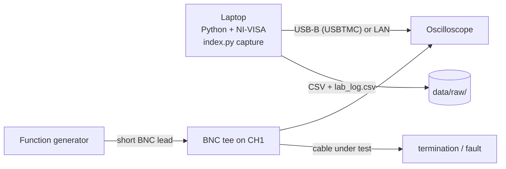

**What to do.** Install NI-VISA, plug the scope's rear USB-B port into the laptop (set the scope's USB mode to USBTMC if it asks), then run:
```powershell
python index.py check
python index.py capture --list
```
**Expected output.** `capture --list` prints something like `USB0::0x1AB1::...::INSTR -> RIGOL TECHNOLOGIES,DS1054Z,...`.

**Pass:** the scope's `*IDN?` string appears. **If not:** use CSV export to a USB stick ([HARDWARE_REPORT.md §6](HARDWARE_REPORT.md#6-if-usb-capture-is-not-possible)).

---

## H3: Generator check (rise time and output resistance)

**Circuit**

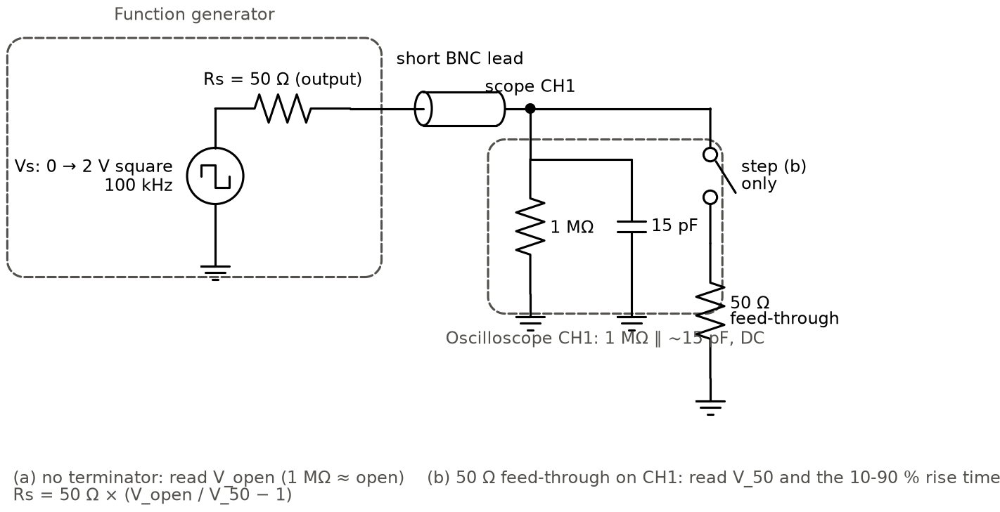

**What to do.**
1. Set the generator to a square wave, 100 kHz, 0 → 2 V, High-Z mode, output ON.
2. **(a)** Generator → short lead → CH1 with **no** terminator (1 MΩ is effectively open). Read the plateau: **V_open**.
3. **(b)** Add the **50 Ω feed-through** on CH1. Read the plateau **V_50** and the **10–90% rise time** (scope measure menu).
4. Compute Rs = 50 Ω × (V_open / V_50 − 1). The system rise time is t_r ≈ the measured 10–90%; the resolution is Δd_min ≈ vp·t_r/2.

**Expected scope picture**

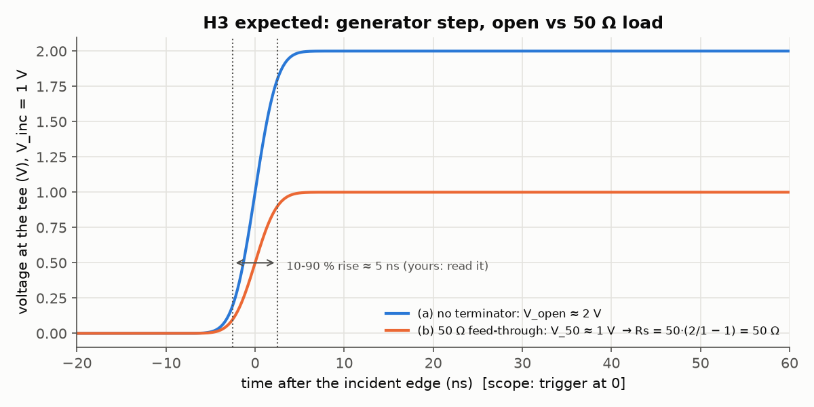

**Expected numbers:**
- V_open ≈ 2.0 V and V_50 ≈ 1.0 V, so Rs ≈ 50 Ω.
- Rise time: 3–15 ns depending on the generator and scope (typical function generator 5–10 ns), which gives Δd_min ≈ 0.3–1.5 m.

**Pass:**
- Rs = 45–55 Ω.
- Rise time written into the equipment table (hardware report §5.1).
- If Δd_min > 0.5 m, use cables ≥ 2 m and consider H10.

---

## H4: Basic TDR setup

**Circuit** (shown here with an open end)

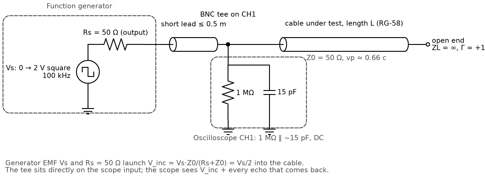

**What to do.**
1. Put the tee **directly on CH1**, the short lead from the generator on one side, and the cable under test on the other.
2. Scope settings: 1 MΩ, DC coupling, bandwidth limit off, trigger on the rising edge at ≈ 0.5 V in Normal mode, trigger 1–2 divisions from the left, timebase from the [LAB_PROCEDURE.md §4](LAB_PROCEDURE.md#4-instrument-settings) table.
3. Take a photo of the setup and draw the diagram; this is a deliverable.

**Expected output:**
- A clean incident step from 0 to **≈ 1.0 V** (V_inc = Vs/2) at t = 0, with a flat plateau until the first echo.
- One test capture: `python index.py capture --length <L> --termination open --repeats 1`. It prints `dt ... d ...`, and d should be within about 10% of the tape length.

**Pass:** the plateau is flat (no ringing larger than about 5%), and the echo appears where the quick reference predicts.

---

## H5: Calibration (open circuit on ≥ 2 lengths, plus matched)

**Circuit: open end** (used for vp)

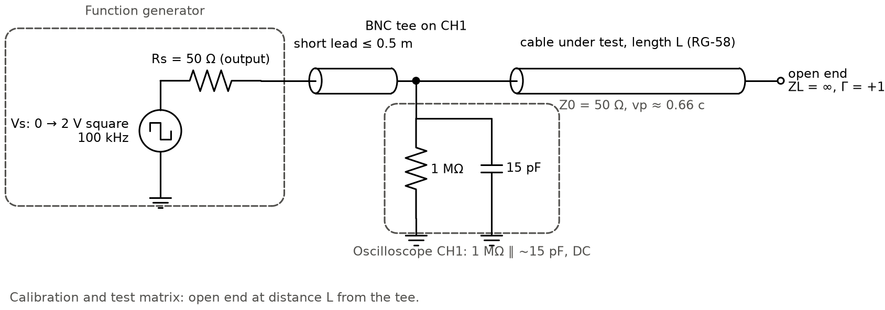

**Circuit: matched end** (used for the V_inc reference)

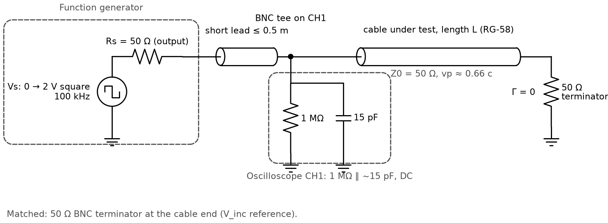

**What to do.**
1. Measure each cable 3 times with the tape.
2. For **each of ≥ 2 lengths**, take 20 open-circuit traces with scope averaging 16:
   ```powershell
   python index.py capture --cable RG-58 --cable-id C1 --length-meas 2.01 2.02 2.01 --termination open --repeats 20 --averaging 16
   ```
3. Take 10 matched traces (50 Ω terminator):
   ```powershell
   python index.py capture --cable RG-58 --cable-id C1 --length-meas 2.01 2.02 2.01 --termination matched --zl 50 --repeats 10 --averaging 16
   ```
4. Run `python index.py calibrate`.

**Expected scope pictures:** open (left) steps up to 2 V at 2L/vp; matched (right) stays flat at 1 V.

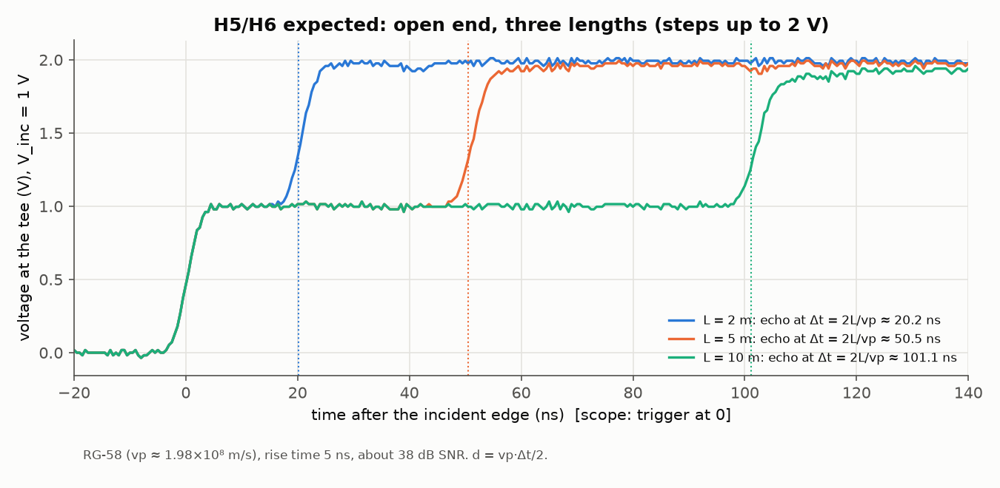

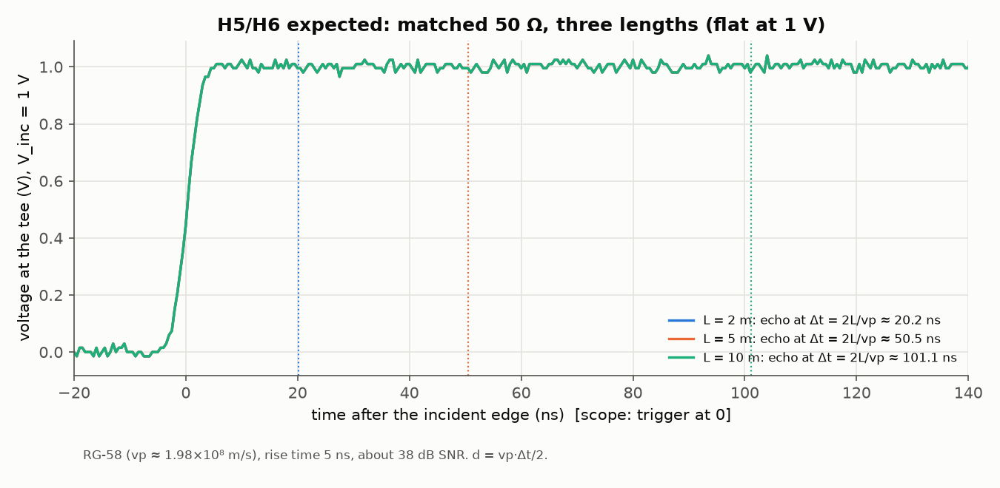

**Expected numbers** (printed by `calibrate` and stored in `data/calibration.json`):

| Quantity | Expected for RG-58 (solid PE) |
|---|---|
| vp | 1.92–2.04 ×10⁸ m/s (VF 0.64–0.68); foam cables 2.3–2.5 ×10⁸ |
| σ(vp)/vp | < 1 % |
| t_offset (tee and trigger) | \|t0\| < 3 ns |
| rise time | your H3 value ± 20 % |
| resolution Δd_min | vp·t_r/2 |
| V_inc | ≈ 1.0 V (with 0 → 2 V High-Z) |
| noise σ | a few mV with averaging |

Note: the 50%-timing vp reads about 0.5–1% low because of dispersion. `python index.py fit --file <an open trace> --length <L> --termination open` gives the dispersion-corrected value; report both.

**Files:** `data/calibration.json`, `report/figures/fig0_calibration.png` (Δt vs L with the fit), `report/results/calibration_traces.csv`.

---

## H6: Test matrix (open / short / matched × 3 lengths × 20 repeats)

**Circuits:** open ([c03](circuits/c03_open_end.png)), matched ([c05](circuits/c05_matched_end.png)), and short:

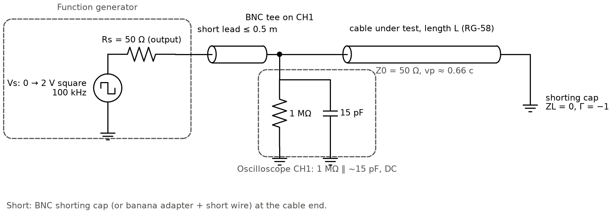

**What to do.** For L ≈ 2, 5 and 10 m and each termination, take 20 repeats in **Normal** acquisition. Reconnect the load every 5 repeats.
```powershell
python index.py capture --cable RG-58 --cable-id C2 --length-meas 5.02 5.01 5.02 --termination short --repeats 20
```

**Expected scope pictures:** open → [w03](circuits/w03_open_end.png), matched → [w05](circuits/w05_matched_end.png), short:

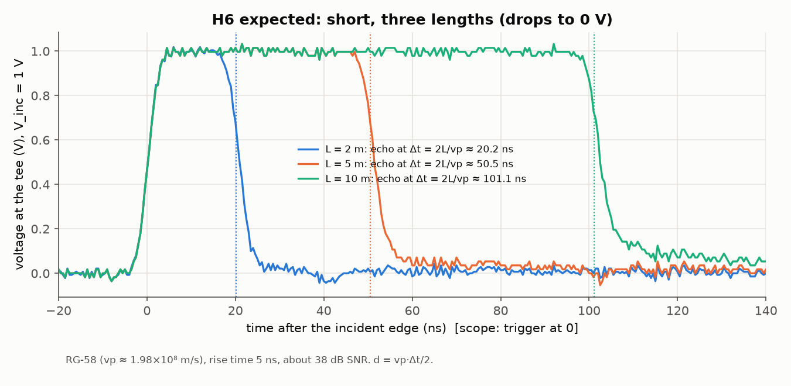

**Expected numbers** (datasheet vp; yours from H5):

| L | Δt open / short | Level open | Level short | Level matched |
|---|---|---|---|---|
| 2 m | ≈ 20.2 ns | 2.0 V | 0 V | 1.0 V |
| 5 m | ≈ 50.5 ns | ≈ 1.95 → 2.0 V | ≈ 0.05 → 0 V | 1.0 V |
| 10 m | ≈ 101 ns | ≈ 1.9 → 2.0 V | ≈ 0.1 → 0 V | 1.0 V |

The quick check printed by `capture` should give the correct class for every repeat. After calibration it should give d within ±0.2 m of the tape length. Before calibration the datasheet vp can be off by up to ±3% (±0.3 m at 10 m).

**Files:** ≈ 180 CSV traces in `data/raw/session_<date>/` and one row per trace in `data/raw/lab_log.csv`.

---

## H7: Partial mismatches (only the instructor-approved ones)

Measure the distance **d from the tee to the discontinuity** with the tape and pass it as `--fault-position`. Take 20 repeats per configuration.

### H7a: Resistive load at the cable end

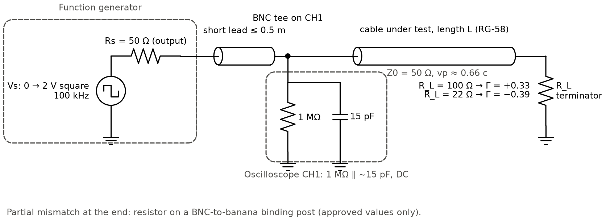

```powershell
python index.py capture --length-meas 5.02 5.01 5.02 --termination partial --fault-kind end --zl 100 --repeats 20
```
**Expected:** step to **1.33 V** (100 Ω) or down to **0.61 V** (22 Ω) at 2L/vp.

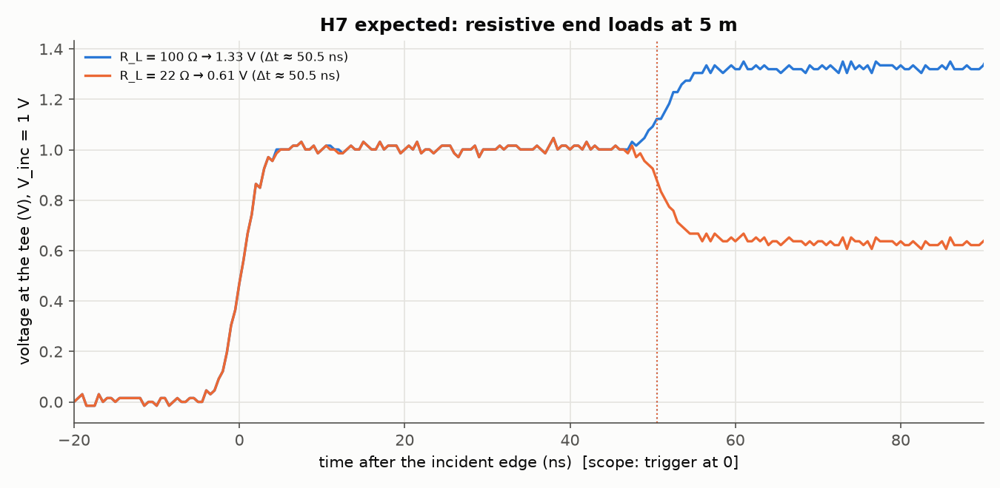

### H7b: Series resistor mid-line

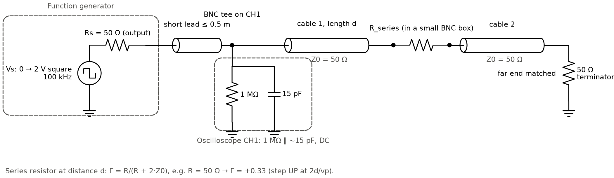

```powershell
python index.py capture --length 5.0 --termination partial --fault-kind series_R --fault-position 3.0 --zl 50 --desc "50R series in BNC box" --repeats 20
```
**Expected:** step **up** to 1.33 V at 2d/vp; the far end is matched, so no second echo.

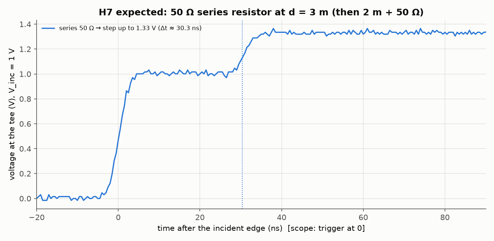

### H7c: Shunt resistor mid-line (partial short)

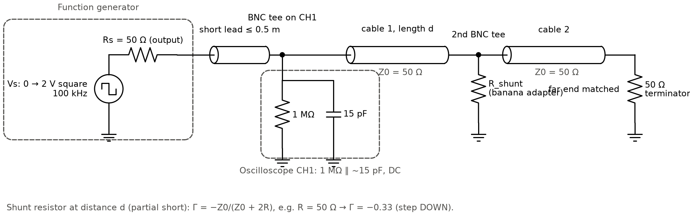

```powershell
python index.py capture --length 5.0 --termination partial --fault-kind shunt_R --fault-position 3.0 --zl 50 --desc "50R shunt on 2nd tee" --repeats 20
```
**Expected:** step **down** to 0.67 V at 2d/vp.

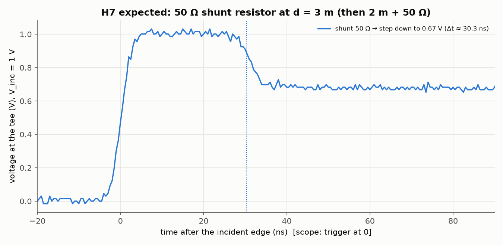

### H7d: 50/75 Ω joint

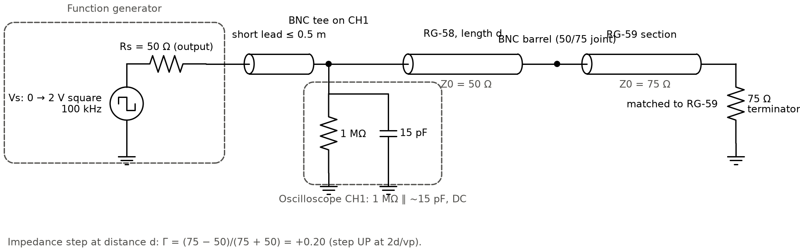

```powershell
python index.py capture --length 5.0 --termination partial --fault-kind impedance_step --fault-position 3.0 --zl 75 --desc "RG-59 2 m + 75R" --repeats 20
```
**Expected:** step **up** to 1.2 V at 2d/vp (Γ = +0.2).

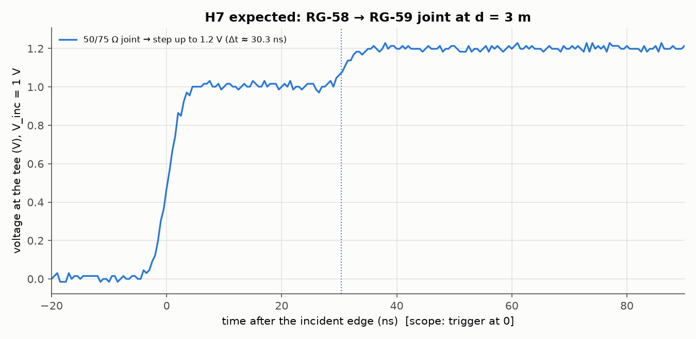

### H7e: Tee with open stub

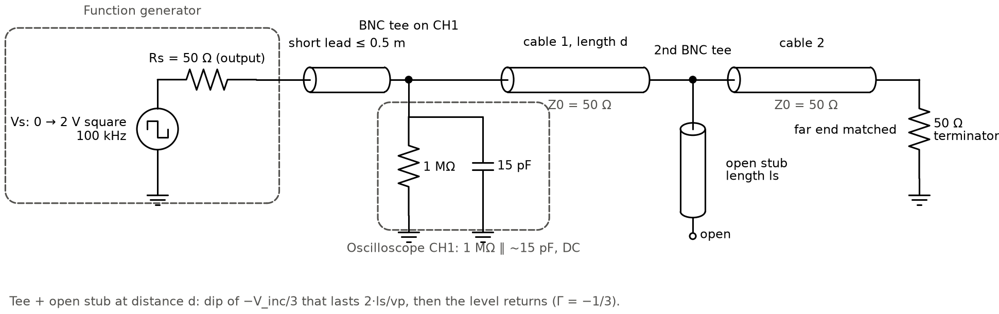

```powershell
python index.py capture --length 5.0 --termination partial --fault-kind open_stub --fault-position 3.0 --desc "stub 1.0 m" --repeats 20
```
**Expected:** a dip to about 0.67–0.7 V starting at 2d/vp and lasting 2·ls/vp (1 m stub → ≈ 10 ns), a small overshoot (about 1.1 V), then back to 1 V.

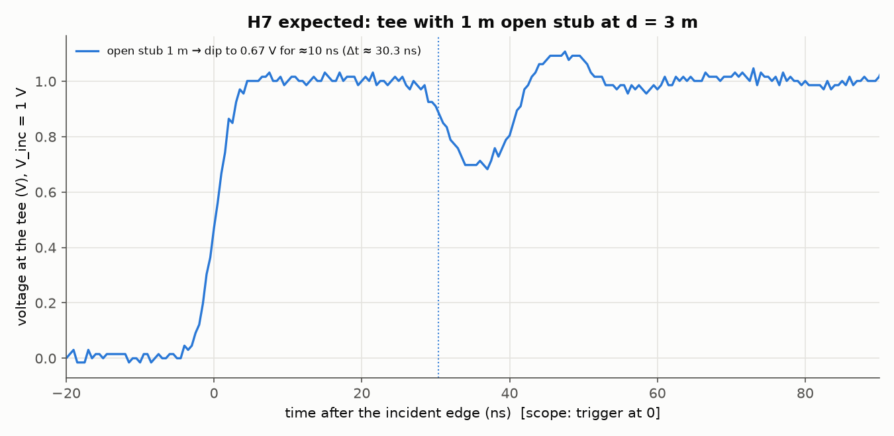

**Pass for all H7:**
- The quick check reports class `partial`, and d within ±0.3 m of the tape value.
- The step direction matches the sign of Γ.

---

## H8: Low-SNR variants

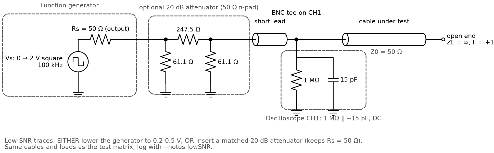

**What to do.** Repeat 2–3 configurations (for example 5 m open, 5 m short, H7a) with **lower amplitude**. Either set the generator to 0 → 0.2–0.5 V, or insert a **matched 20 dB attenuator**, which keeps Rs = 50 Ω (π-pad 61.1 / 247.5 / 61.1 Ω). Add `--notes lowSNR`.

**Expected scope picture**

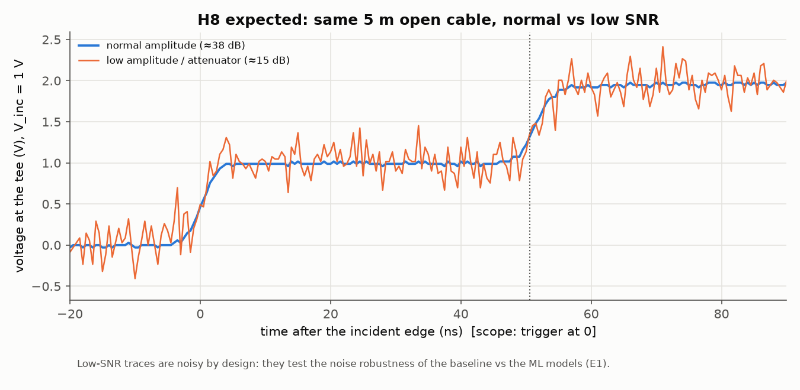

**Expected numbers:**
- V_inc drops to 0.1–0.25 V; the noise stays the same, so the SNR falls by 12–20 dB.
- The baseline will sometimes miss the echo; that is the point of E1.

---

## H9: Processing the lab data (no circuit)

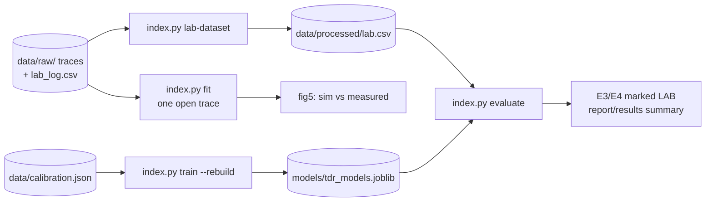
**Expected output:**
- `report/results/summary.md` shows `E3/E4 ... (LAB ...)` instead of `PROXY`.
- Figure 5 shows the fitted simulation on top of a measured trace.
- The dashboard's "Saved trace" source lists the lab files with predictions from every model.

---

## H10: Optional fast-edge pulser (instructor approval needed)

**Schematic** (74AC14, 5 V):

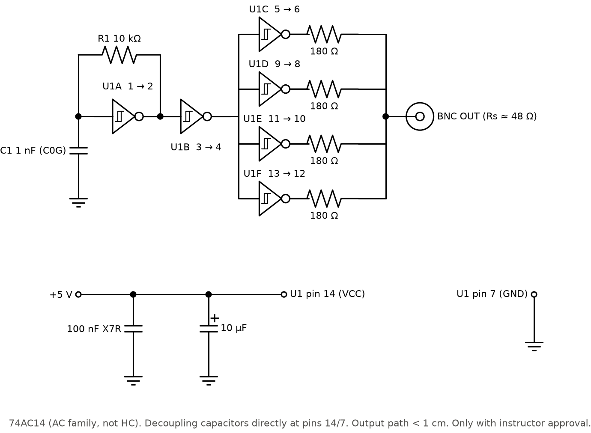

**Bring-up test circuit:**

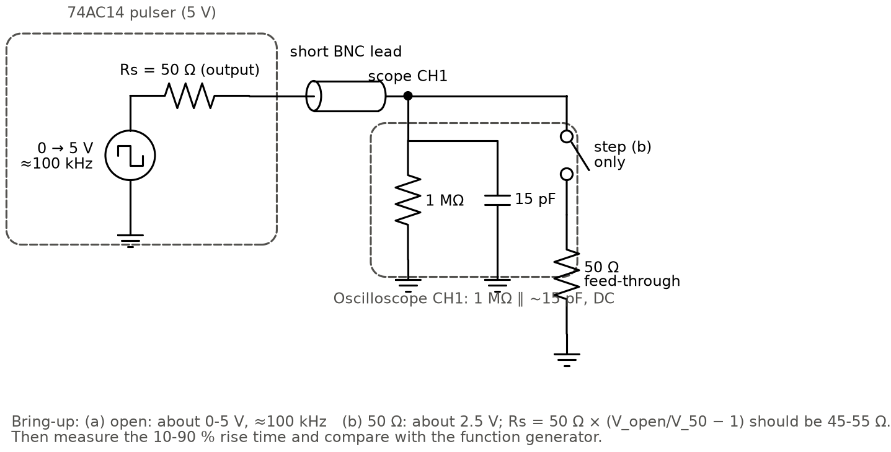

**What to do.**
1. Build the circuit on copper-clad board with a ground plane, keeping the output path < 1 cm ([fast_edge_pulser.md](fast_edge_pulser.md)).
2. Test it as in H3: open, then the 50 Ω feed-through.
3. Repeat H5 with the pulser and `--gen-model "74AC14 pulser"`.

**Expected output:**
- Open: 0 → 5 V square at about 100 kHz.
- With 50 Ω: ≈ 2.5 V, so Rs ≈ 45–55 Ω.
- 10–90% edge ≈ 2–3 ns, until the scope bandwidth limits it.
- On a 1 m open cable, the echo separates from the incident edge (below). With the slow generator edge it merges.

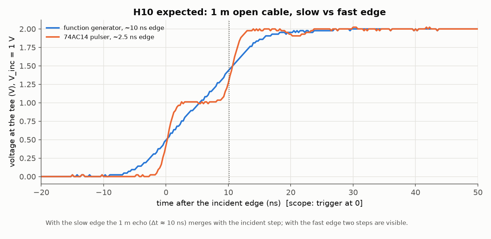

**Pass:** Rs = 45–55 Ω, and the measured rise time is clearly shorter than the generator's (H3).

---

## Checklist before leaving the lab
- [ ] `data/calibration.json` written; VF within range
- [ ] about 180 matrix traces + H7 + H8 traces, all logged
- [ ] the quick check matched the tape length for every configuration
- [ ] setup photo taken; equipment table filled
- [ ] `data/raw` copied to a second place
