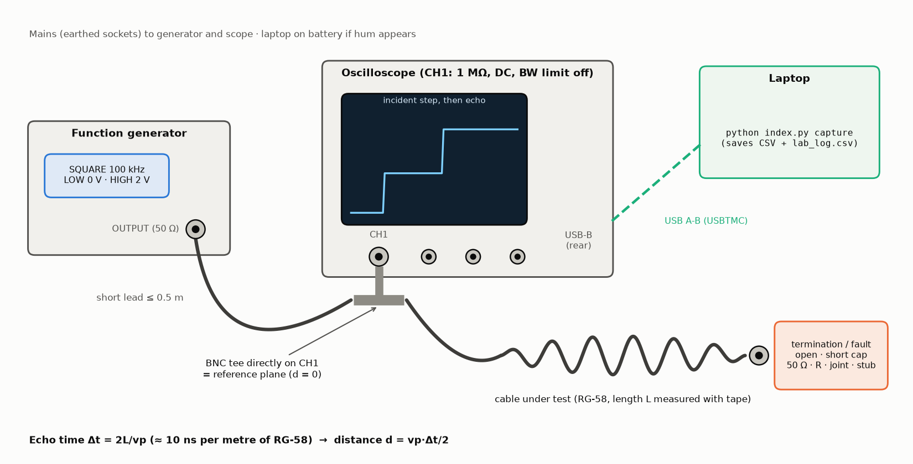
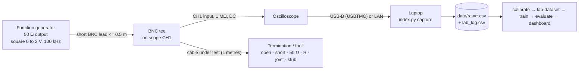
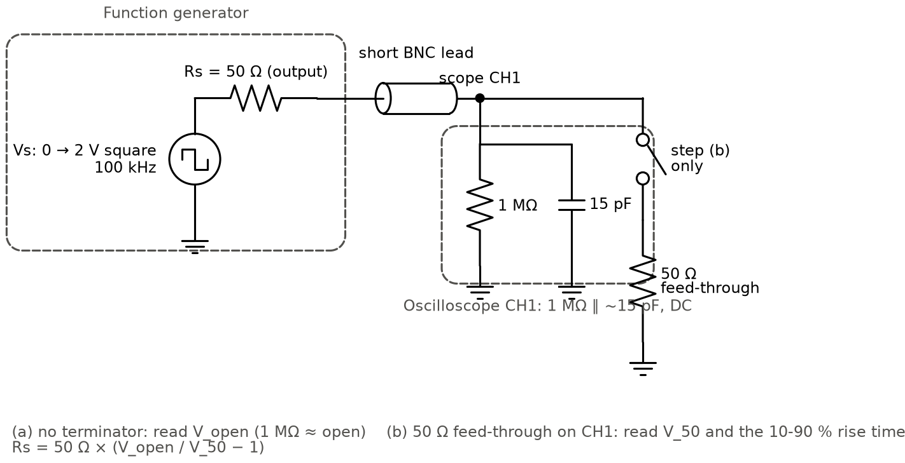
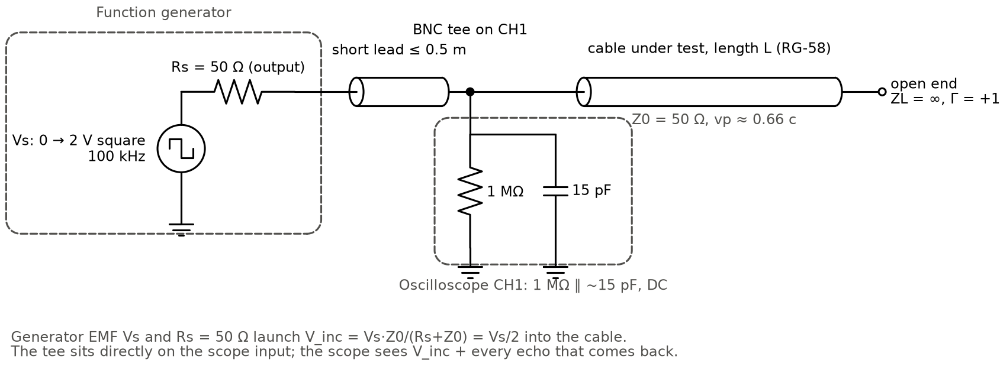
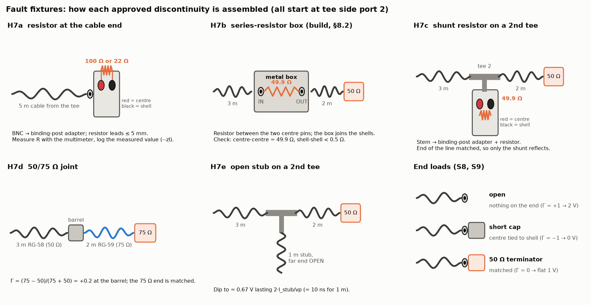
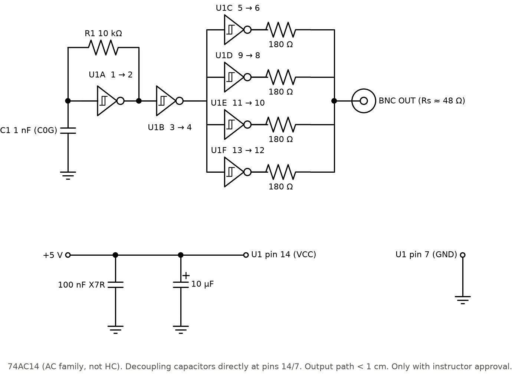
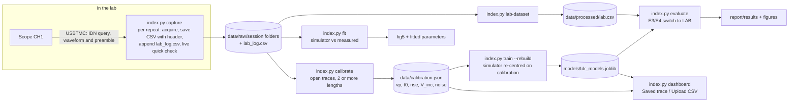

# Hardware: start here (beginner's step-by-step manual)

This is the **entry point for all hardware work**. It lists everything you need, every connection, and every step **in the order you do them**. For each step it says what to do, why, what you need, how to do it and how to check it worked. You don't need prior lab experience: follow the steps top to bottom.

Deeper detail lives in four companion files. You only need them when a step points to them:

| File | What it adds |
|---|---|
| [HARDWARE_GUIDE.md](HARDWARE_GUIDE.md) | every task's **circuit diagram + simulated expected scope picture** + pass criteria |
| [LAB_PROCEDURE.md](LAB_PROCEDURE.md) | exact instrument settings, timebase table, printable log sheet |
| [HARDWARE_REPORT.md](HARDWARE_REPORT.md) | the plan: instructor questions, team roles, 3-hour time plan, risks, what to report |
| [fast_edge_pulser.md](fast_edge_pulser.md) | the optional 74AC14 fast-edge pulser (H10) |
| [circuits/](circuits/) | all schematics (`c*.png/svg`), expected waveforms (`w*.png`) and wiring pictures (`p*.png`); regenerate with `python hardware/circuits/make_hardware_figures.py` |

---

## 1. What the hardware does, in one picture

A **function generator** sends a voltage step into a coaxial cable. Wherever the cable's impedance changes (open end, short, resistor, joint), part of the step **reflects back**. An **oscilloscope** connected at the cable's input (through a BNC tee) records the outgoing step and the echo. The time between them, Δt, gives the distance d = vp·Δt/2. The echo's height and sign tell you what kind of fault it is. A **laptop** reads the waveform over USB and runs the project software: baseline, ML models and dashboard.





**There is no microcontroller and no firmware to write.** The "hardware" is standard lab instruments, coaxial cables, BNC adapters and a few resistors, plus one optional logic-gate circuit (H10). Section 7 lists the driver and instrument configuration.

---

## 2. Status of the hardware work

The software side of every step is **built and rehearsed**. `python index.py selftest` runs the full capture → calibrate → fit → lab-dataset → train → evaluate → dashboard chain with a simulated scope and passes ([report/results/feature_tests.md](../report/results/feature_tests.md)). What remains needs the physical lab.

| Step | Task | Status | Blocked by |
|---|---|---|---|
| S1 | Instructor approvals (H1) | **Not started** | lab / instructor meeting |
| S2 | Collect and check parts | **Not started** | S1 (which parts are approved) |
| S3 | Laptop preparation + rehearsal | **Ready**: software installed, rehearsal command tested | – |
| S4 | Equipment discovery | **Not started** | lab access |
| S5 | Laptop ↔ scope connection (H2) | **Not started**: drivers for Rigol, Keysight/Agilent, Tektronix and Siglent written; untested on a real scope | lab access |
| S6 | Generator check (H3) | **Not started** | lab access |
| S7 | Basic TDR setup (H4) | **Not started** | S6 |
| S8 | Calibration (H5) | **Not started**: `calibrate` tested on simulated traces (vp within 0.9 %) | S7 |
| S9 | Test matrix (H6) | **Not started** | S8 |
| S10 | Partial faults (H7a–e) | **Not started** | S1 approvals |
| S11 | Low-SNR traces (H8) | **Not started** | S9 |
| S12 | Data check + backup | **Not started** | S9–S11 |
| S13 | Process lab data (H9) | **Ready**: every command tested end to end on simulated captures | S12 |
| S14 | Update report with measured numbers | **Not started** | S13 |
| S15 | Optional fast-edge pulser (H10) | **Optional**: schematic, BOM and test plan ready | instructor approval |

---

## 3. Complete component list (bill of materials)

Tick the last column while collecting parts (S2). "Steps" refers to section 9.

### 3.1 Instruments and computer

| # | Component | Specification (minimum → preferred) | Qty | Purpose | Steps | ☐ |
|---|---|---|---|---|---|---|
| 1 | Function generator | 50 Ω output; square or pulse; levels settable to 0 V / 2 V; ≥ 1 MHz; edge ≤ 15 ns → ≤ 5 ns | 1 | makes the incident step | S6–S11 | ☐ |
| 2 | Digital storage oscilloscope | ≥ 100 MHz → 200 MHz bandwidth; ≥ 500 MSa/s → 1 GSa/s on one channel; 1 MΩ BNC input; USB "device" port (USBTMC) or LAN; CSV export | 1 | records incident + reflected wave | S5–S11 | ☐ |
| 3 | Laptop | Windows 10/11; Python 3.11+ (tested 3.13); 1 free USB-A port; ≥ 3 GB free disk | 1 | capture, processing, ML, dashboard | S3, S5, S13 | ☐ |
| 4 | USB cable A → B ("printer cable") | ≤ 2 m | 1 | laptop ↔ scope (rear USB-B "Device" port) | S5 | ☐ |
| 5 | Digital multimeter | Ω range with 0.1 Ω resolution, continuity beeper | 1 | checks resistors, terminators, cable continuity / shorts | S2 | ☐ |

### 3.2 Cables and adapters

| # | Component | Specification | Qty | Purpose | Steps | ☐ |
|---|---|---|---|---|---|---|
| 6 | Coaxial cable, BNC male both ends | RG-58 (Z0 = 50 Ω, VF ≈ 0.66, solid PE), lengths ≈ **2 m, 5 m, 10 m**; all the **same type** | 3 | the cables under test | S8–S11 | ☐ |
| 7 | Extra RG-58 pieces, BNC male both ends | ≈ 3 m + ≈ 2 m (mid-line faults), ≈ 1 m (stub) | 3 | build faults in the middle of a line | S10 | ☐ |
| 8 | Short BNC lead | RG-58, BNC male–male, **≤ 0.5 m** | 1 | generator → tee (keeps secondary echoes away) | S6–S11 | ☐ |
| 9 | BNC T-adapter (tee) | UG-274 style, male–female–female, 50 Ω | 2 | tee 1 on scope CH1; tee 2 for shunt / stub faults | S7–S10 | ☐ |
| 10 | BNC barrel | female–female, 50 Ω | 1 | joins RG-58 to RG-59 (50/75 Ω joint) | S10 | ☐ |
| 11 | RG-59 cable, BNC male both ends | Z0 = 75 Ω, 2–5 m | 1 | the 75 Ω section of the joint fault | S10 | ☐ |

### 3.3 Terminations and fault parts

| # | Component | Specification | Qty | Purpose | Steps | ☐ |
|---|---|---|---|---|---|---|
| 12 | 50 Ω BNC end terminator | male, 50 Ω ± 2 %, ≥ 0.5 W | 1 | the **matched** load (Γ = 0) | S8–S10 | ☐ |
| 13 | 50 Ω BNC feed-through terminator | male–female, 50 Ω ± 2 % | 1 | generator check (H3); can also serve as #12 | S6 | ☐ |
| 14 | BNC shorting cap | male, centre tied to shell | 1 | the **short** load (Γ = −1); alternative: #15 + a wire link | S9 | ☐ |
| 15 | BNC female → dual binding post adapter | red post = centre, black post = shell | 2 | holds resistor loads (end load, shunt) | S10 | ☐ |
| 16 | Resistors, metal film | 1 %, 0.25 W, axial: **22 Ω, 49.9 Ω (or 51 Ω, or 2 × 100 Ω in parallel), 100 Ω** | 2 each | partial faults (Γ = −0.39, ≈ 0, +0.33) | S10 | ☐ |
| 17 | 75 Ω BNC end terminator | male, 75 Ω | 1 | terminates the RG-59 section | S10 | ☐ |
| 18 | Series-resistor box (build it, §8.2) | small die-cast box, 2 × panel BNC female, 1 × 49.9 Ω resistor | 1 | series-resistor fault mid-line | S10 | ☐ |
| 19 | 20 dB BNC attenuator (optional) | 50 Ω, DC–≥ 500 MHz, ≥ 1 W | 1 | low-SNR traces without changing the generator | S11 | ☐ |

Power in these parts is tiny. The largest is about 17 mW in a 22 Ω load with a 2 V step from 50 Ω, so 0.25 W resistors are plenty.

### 3.4 Tools and consumables

| # | Item | Purpose | ☐ |
|---|---|---|---|
| 20 | Tape measure, ≥ 10 m, mm marks | 3 readings per cable length | ☐ |
| 21 | USB stick (FAT32) | CSV fallback if USB capture fails; data backup | ☐ |
| 22 | Phone camera | setup photo (deliverable) | ☐ |
| 23 | Printed log sheet ([LAB_PROCEDURE.md §9](LAB_PROCEDURE.md)) + pen | paper backup of every capture | ☐ |
| 24 | Masking tape + marker | label every cable with its ID and measured length | ☐ |

### 3.5 Optional fast-edge pulser (S15 only)

| Part | Specification | Qty | Purpose |
|---|---|---|---|
| U1 | **74AC14** hex Schmitt inverter, DIP-14 (not 74HC14: too slow) + socket | 1 | oscillator, buffer, 4 parallel output drivers |
| R1 | 10 kΩ, 1 % | 1 | sets the oscillator frequency (≈ 100 kHz with C1) |
| C1 | 1 nF C0G/NP0 | 1 | oscillator timing |
| R2–R5 | 180 Ω, 1 %, short leads or 0805 SMD | 4 | 4 × (180 + ~12) Ω in parallel ≈ 48 Ω source impedance |
| C2 | 100 nF X7R ceramic | 1 | decoupling at pin 14 |
| C3 | 10 µF electrolytic or ceramic | 1 | bulk decoupling |
| J1 | BNC female, PCB/panel mount | 1 | output |
| – | Single-sided copper-clad board ≈ 5 × 5 cm; soldering iron, solder | 1 | ground plane (dead-bug build) |
| – | 5 V supply: USB breakout, power bank, or bench supply | 1 | power (see §4) |

---

## 4. Power requirements

| Equipment | Supply | Typical draw | Notes |
|---|---|---|---|
| Function generator, oscilloscope | lab mains through **earthed** bench sockets, at the voltage on each rear-panel label (usually 100–240 V AC, 50/60 Hz) | < 100 W each | never use adapters that drop the earth pin; the BNC shells are tied to mains earth, which is the common reference of the whole setup |
| Laptop | battery or its own charger | – | if mains hum (50/60 Hz ripple) appears with the charger plugged in, run on battery (ground loop) |
| Cables, adapters, resistors | none (passive) | – | – |
| Fast-edge pulser (optional) | **5.0 V ± 0.25 V DC**, able to supply ≥ 150 mA | ≈ 5–10 mA idle, ≈ 25 mA average into a 50 Ω cable, ≈ 105 mA peak into a shorted cable | USB port or power bank (500 mA) is fine; a bench supply should be set to 5.0 V with a **150–200 mA current limit**; reversed polarity destroys the chip |

**Signal levels used everywhere:** generator 0 → 2 V. That is 1 V at the tee, and at most 2 V with an open end. The pulser gives about 2.5 V into the cable and at most 5 V with an open end. Both are far below a 1 MΩ scope input's rating (typically 300 V).

---

## 5. Connection diagrams and port-to-port tables

Distances are always measured **from the tee**. Every connection is a BNC bayonet: push and turn until it locks. "M" means male (pin) and "F" means female (socket).

### 5.1 Setup A: generator check (S6, circuit c01)



| # | From (port, connector) | Via | To (port, connector) |
|---|---|---|---|
| A1 | Generator **OUTPUT** (CH1), BNC F | short lead #8 (M–M) | scope **CH1** input, BNC F (measurement **a**: nothing else) |
| A2 | – | 50 Ω feed-through #13 placed **on scope CH1** | the short lead plugs into the feed-through (measurement **b**) |
| A3 | Laptop USB-A | USB cable #4 | scope rear **USB Device** (USB-B) |

### 5.2 Setup B: the TDR measurement (S7–S9, circuits c02–c05)



| # | From (port, connector) | Via | To (port, connector) |
|---|---|---|---|
| B1 | Scope **CH1** input, BNC F | – | tee #9 **male stem**, mounted **directly** on CH1 (no lead in between) |
| B2 | Generator **OUTPUT**, BNC F | short lead #8 (M–M) | tee side port 1, BNC F |
| B3 | Tee side port 2, BNC F | – | cable under test #6, end A (BNC M) |
| B4 | Cable end B (BNC M) | – | **open**: nothing · **short**: shorting cap #14 · **matched**: 50 Ω terminator #12 |
| B5 | Laptop USB-A | USB cable #4 | scope rear USB Device (USB-B) |

### 5.3 Fault set-ups (S10, circuits c06–c10)

All start from setup B (B1, B2, B5). Only what is attached to tee side port 2 changes.

| Fault | Port-to-port chain from tee side port 2 | Expected level at the tee (V_inc = 1 V) | Circuit |
|---|---|---|---|
| H7a resistive end load | 5 m cable → binding-post adapter #15 → resistor #16 (100 Ω or 22 Ω) between red and black posts, leads ≤ 5 mm | 1.33 V (100 Ω) / 0.61 V (22 Ω) | [c06](circuits/c06_resistive_end.png) |
| H7b series resistor | 3 m cable → series box #18 (IN) → series box (OUT) → 2 m cable → 50 Ω terminator #12 | 1.33 V | [c07](circuits/c07_series_resistor.png) |
| H7c shunt resistor | 3 m cable → tee 2 side port · tee 2 stem → binding-post adapter #15 with 49.9 Ω · tee 2 other side → 2 m cable → 50 Ω terminator | 0.67 V | [c08](circuits/c08_shunt_resistor.png) |
| H7d 50/75 Ω joint | 3 m RG-58 → barrel #10 → 2 m RG-59 #11 → 75 Ω terminator #17 | 1.2 V | [c09](circuits/c09_75ohm_joint.png) |
| H7e open stub | 3 m cable → tee 2 side port · tee 2 stem → 1 m stub, far end **open** · tee 2 other side → 2 m cable → 50 Ω terminator | dip to ≈ 0.67–0.7 V for 2·l_stub/vp, then 1 V | [c10](circuits/c10_tee_open_stub.png) |
| H8 low SNR | generator OUTPUT → 20 dB attenuator #19 → short lead → tee (rest as setup B), **or** generator set to 0 → 0.2–0.5 V | same shapes at 1/10 the size, noisier | [c11](circuits/c11_low_snr.png) |

How the fault fixtures look when assembled:



### 5.4 Pulser pin-to-pin table (S15 only, circuit c12)



| 74AC14 pin | Name | Connects to |
|---|---|---|
| 1 | 1A (input, gate A) | R1 end 1 and C1 top |
| 2 | 1Y (output, gate A) | R1 end 2 (feedback) and pin 3 |
| 3 | 2A (input, gate B) | pin 2 |
| 4 | 2Y (output, gate B) | pins 5, 9, 11, 13 (all four driver inputs) |
| 5, 9, 11, 13 | 3A, 4A, 5A, 6A (driver inputs) | pin 4 |
| 6, 8, 10, 12 | 3Y, 4Y, 5Y, 6Y (driver outputs) | each through its own 180 Ω (R2–R5) to the **BNC J1 centre pin** |
| 7 | GND | ground plane: C1 bottom, C2 and C3 negative, BNC J1 shell, supply 0 V |
| 14 | VCC | +5 V supply, C2 (100 nF) and C3 (10 µF) positive, as close to the pin as possible |

---

## 6. Software and instrument configuration ("firmware")

There is **no firmware to write or flash**. The instruments run their own firmware unchanged, and the pulser has no programmable part. What you need to configure:

| Item | Setting | Where | Check |
|---|---|---|---|
| Python environment | `python -m venv .venv`, then `.venv\Scripts\pip install -r requirements.txt`; for the CNN: `pip install torch --index-url https://download.pytorch.org/whl/cpu` | laptop | `python index.py check` prints `[ok]` for every package |
| VISA driver | **NI-VISA** (or Keysight IO Libraries Suite). Driver-free alternative: `pyvisa-py` + `pyusb` (already in requirements) | laptop | `python index.py check` lists a VISA backend |
| Scope USB mode | USB device class **USBTMC** (Rigol: Utility → IO Setting → USB Device; others: "USB Device Port = Computer") | scope | `capture --list` shows `USB0::...::INSTR -> <IDN>` |
| Scope over LAN (alternative) | DHCP or a static IP on the same subnet as the laptop; resource string `TCPIP::<ip>::INSTR` | scope Utility → LAN | `python index.py capture --resource TCPIP::<ip>::INSTR --length 2 --termination open --repeats 1` |
| Scope firmware version | read the 4th field of `*IDN?` and write it in the equipment table | – | nothing to update |
| Supported scope command sets | Rigol (DS1000Z/DS2000/MSO5000: `:WAV:` commands), Keysight/Agilent (`:WAVeform:`), Tektronix (`CURVE?`), Siglent (`C1:WF? DAT2`); unknown vendors fall back to Keysight-style SCPI | `src/capture.py` | first real capture in S5 |
| Generator | manual front panel: square, 100 kHz, low 0 V, high 2 V, record the **High-Z / 50 Ω load setting** | generator | plateau ≈ 1 V at the tee (S7) |
| Scope channel settings | 1 MΩ, DC, BW limit **off**, probe 1X, 500 mV/div, trigger rising edge ≈ 0.5 V, mode **Normal**, other channels off | scope | full table in [LAB_PROCEDURE.md §4](LAB_PROCEDURE.md#4-instrument-settings) |
| Calibration file | written by `index.py calibrate` to `data/calibration.json`; every later command reads it automatically | laptop | `python index.py check` says `calibration: yes` |

---

## 7. Hardware-software integration

How a measurement travels through the software, and which command connects each stage:



**Integration procedure (do it once in S3 at home, again for real in S13):**
1. `capture` saves every trace as a CSV with a `#`-header holding all its labels, and appends the same labels to `lab_log.csv`. The log is the single link between a file and its ground truth.
2. `calibrate` reads only the **open-circuit, end-fault** rows of the log, fits Δt = 2L/vp + t0, and writes `calibration.json`.
3. Every later command (`inspect`, `capture`'s quick check, `lab-dataset`, `train`, `evaluate`, `dashboard`) loads `calibration.json` automatically. No flags are needed.
4. `lab-dataset` runs the same preprocessing, baseline and feature code as the simulated data, so lab and simulated rows are directly comparable.
5. `train --rebuild` re-simulates the training set with vp, rise time, V_inc and noise centred on the calibration, then retrains every model.
6. `evaluate` uses the lab log automatically once it contains ≥ 20 traces. E3/E4 are then marked **LAB** instead of **PROXY**.

**Verified so far:** this whole chain runs end to end with the simulated scope (`python index.py selftest`, features F02–F06 and F13). The only untested link is the real USBTMC transfer from your specific scope (S5).

---

## 8. Assembly instructions

### 8.1 Labelling and checking parts (no soldering)
1. Put a strip of masking tape on each cable near one end. Write its ID (C1, C2, …), type (RG-58) and, later, the measured length.
2. **Cable check with the multimeter.** Each cable needs three readings:
   - centre-to-centre between the two ends: < 1 Ω (continuity);
   - shell-to-shell: < 1 Ω;
   - centre-to-shell, ends open: open circuit (OL).
3. **Terminator check:** a 50 Ω terminator should measure 49–51 Ω between pin and shell, and the shorting cap < 0.5 Ω.
4. **Resistor check:** measure each resistor and write the measured value in the log (`--zl`), not the nominal one.

### 8.2 Series-resistor box (fault H7b, only if approved)
1. Drill two holes in a small die-cast (metal) box, 2–3 cm apart, and mount two **panel BNC female** jacks.
2. Solder a **49.9 Ω** resistor directly between the two centre pins, with leads trimmed to ≤ 5 mm.
3. The metal box connects both jack shells. In a plastic box, solder a short thick wire between the two shell lugs instead.
4. Check with the multimeter: centre-to-centre ≈ 49.9 Ω, shell-to-shell < 0.5 Ω, centre-to-shell open.

### 8.3 Resistor loads on binding posts (H7a, H7c)
1. Bend the resistor leads so the resistor sits right on the posts. Insert one lead in the **red** (centre) post and one in the **black** (shell) post, and tighten.
2. Keep the leads **as short as possible**. Every extra centimetre adds inductance and rings the edge.
3. Measure across the posts with the multimeter before connecting.

### 8.4 Fault chains (H7b–H7e)
Assemble them exactly as the port-to-port chains in §5.3. Measure the distance **from the tee on the scope to the fault point** with the tape (cable 1 length plus the tee/barrel), and pass it as `--fault-position`.

### 8.5 Fast-edge pulser (S15, optional; full notes in [fast_edge_pulser.md](fast_edge_pulser.md))
1. Use the copper side of the board as a continuous **ground plane**. Glue the 74AC14 socket upside down ("dead-bug"), or use Manhattan pads.
2. Solder pin 7 and the BNC shell straight to the plane. Put C2 (100 nF) and C3 (10 µF) right at pins 14/7.
3. Wire the pins as in the §5.4 table. Keep each output → 180 Ω → BNC centre path **under 1 cm**.
4. Before inserting the chip, check with the multimeter that pin 14 and pin 7 are not shorted.
5. Bring-up test: §9, step S15.

---

## 9. The steps, in order

Each step lists **What**, **Why**, **You need**, **How** and **Done when**. Tasks H1–H10 match the hardware report and the guide.

### S1. Get approvals (H1)
- **What:** ask the instructor the six questions in [HARDWARE_REPORT.md §3.1](HARDWARE_REPORT.md#31-questions-for-the-instructor) and write down the answers.
- **Why:** only approved cables, loads and discontinuities may be used. The answers decide which H7 faults you build and whether a long square wave counts as the "low-voltage pulse".
- **You need:** the question list.
- **How:** meet the instructor or send the questions. Note which of H7a–e are approved, the voltage limits, whether USB connection to the scope is allowed, and whether the pulser is allowed.
- **Done when:** answers are recorded in the hardware report §3.1, and the BOM (§3) is marked with the approved options.

### S2. Collect and check the parts
- **What:** gather every ticked part in §3, label the cables, and check them (§8.1).
- **Why:** a broken cable or a wrong resistor gives believable but wrong data. That's much harder to find later than now.
- **You need:** the parts list, a multimeter, masking tape.
- **How:** follow §8.1. Build the series box (§8.2) only if H7b was approved.
- **Done when:** every row in §3 is ticked, and every cable, terminator and resistor passed its multimeter check.

### S3. Prepare the laptop and rehearse at home
- **What:** install the software and run the whole session against the simulated scope.
- **Why:** lab time is short. Every software problem found at home saves lab time.
- **You need:** the laptop, internet (for installation).
- **How:**
  ```powershell
  cd D:\EMT
  .venv\Scripts\python index.py check
  .venv\Scripts\python index.py selftest --fast
  .venv\Scripts\python index.py capture --simulate --length 5 --termination open --repeats 5
  ```
  Install NI-VISA. Print the log sheet ([LAB_PROCEDURE.md §9](LAB_PROCEDURE.md)). Charge the laptop.
- **Done when:** `check` shows `[ok]` for every package, `selftest --fast` reports no Fail, and the simulated capture prints a distance near 5 m for each repeat.

### S4. Equipment discovery (first 15 minutes in the lab)
- **What:** write down the generator and scope models, scope bandwidth and sample rate, generator edge time, and the cable type printed on the jacket.
- **Why:** these numbers set the resolution (Δd_min ≈ vp·t_r/2) and go into the report's equipment table.
- **You need:** the equipment table ([HARDWARE_REPORT.md §5.1](HARDWARE_REPORT.md#51-equipment-discovery-fill-in-on-the-day)).
- **How:** read the front panels, and the scope's Utility → System Info menu.
- **Done when:** the table is filled in.

### S5. Connect the laptop to the scope (H2)
- **What:** make the laptop see the scope over USB.
- **Why:** Python capture logs every trace with its labels automatically, which avoids mislabelled files, the most common data error.
- **You need:** USB cable #4, NI-VISA installed.
- **How:** connect as in A3/B5, set the scope's USB mode to USBTMC (§6), then run `python index.py capture --list`.
- **Done when:** the scope's `*IDN?` string is printed. **If not:** work through the troubleshooting table (§10). If it still fails, use CSV export to a USB stick ([HARDWARE_REPORT.md §6](HARDWARE_REPORT.md#6-if-usb-capture-is-not-possible)); the rest of the pipeline is identical.

### S6. Check the generator (H3): circuit [c01](circuits/c01_generator_check.png), expected [w01](circuits/w01_generator_check.png)
- **What:** measure the generator's open-circuit and 50 Ω-loaded plateaus and its 10–90 % rise time.
- **Why:** this confirms the generator really has a 50 Ω output, which absorbs returning echoes. The rise time sets the best possible resolution.
- **You need:** generator, scope, short lead, 50 Ω feed-through.
- **How:** connections A1, then A2, as in §5.1. Steps in [HARDWARE_GUIDE.md H3](HARDWARE_GUIDE.md#h3-generator-check-rise-time-and-output-resistance).
- **Done when:** V_open ≈ 2.0 V, V_50 ≈ 1.0 V, and Rs = 50 Ω × (V_open/V_50 − 1) is between 45 and 55 Ω. The rise time is written in the equipment table.

### S7. Build the basic TDR setup (H4): circuit [c02](circuits/c02_tdr_setup.png)
- **What:** wire setup B (§5.2) and apply the scope settings (§6).
- **Why:** every later measurement uses exactly this setup. The tee directly on CH1 defines the reference plane (distance 0).
- **You need:** tee, short lead, the 2 m cable.
- **How:** connections B1–B5, then the settings table in [LAB_PROCEDURE.md §4](LAB_PROCEDURE.md#4-instrument-settings). Take a photo and run one test capture:
  `python index.py capture --length 2.0 --termination open --repeats 1`
- **Done when:** a clean step to ≈ 1 V with a flat plateau, the echo where the quick-reference table predicts, and the printed d within about 10 % of the tape length.

### S8. Calibrate (H5): circuits [c03](circuits/c03_open_end.png), [c05](circuits/c05_matched_end.png); expected [w03](circuits/w03_open_end.png), [w05](circuits/w05_matched_end.png)
- **What:** for each of ≥ 2 lengths (2, 5, 10 m), take 20 open-circuit traces, plus 10 matched traces. Then run `python index.py calibrate`.
- **Why:** the propagation velocity vp is the conversion factor from time to distance. Datasheet values can be 3 % off, which is 0.3 m at 10 m.
- **You need:** the three cables, the 50 Ω terminator, the tape measure.
- **How:** measure each cable 3 times, then use the commands in [HARDWARE_GUIDE.md H5](HARDWARE_GUIDE.md#h5-calibration-open-circuit-on--2-lengths-plus-matched).
- **Done when:** `calibrate` reports VF 0.64–0.68 for RG-58 with σ(vp)/vp < 1 % and |t0| < 3 ns. `data/calibration.json` and `fig0_calibration.png` exist.

### S9. Test matrix (H6): circuits c03, [c04](circuits/c04_short_end.png), c05; expected w03, [w04](circuits/w04_short_end.png), w05
- **What:** open, short and matched at 3 lengths, 20 repeats each (≈ 180 traces).
- **Why:** this is the labelled real dataset for E3/E4 (simulation-to-lab transfer) and for classification on real traces.
- **You need:** setup B, shorting cap, terminator.
- **How:** commands in [HARDWARE_GUIDE.md H6](HARDWARE_GUIDE.md#h6-test-matrix-open--short--matched--3-lengths--20-repeats). Reconnect the load every 5 repeats, so the repeats include connector variation.
- **Done when:** ≈ 180 rows in `data/raw/lab_log.csv`, the quick check gives the right class every time, and d is within ±0.2 m of the tape length.

### S10. Partial faults (H7a–e, only approved ones): circuits c06–c10; expected w06–w10
- **What:** build each approved fault (§5.3, §8) and take 20 repeats each.
- **Why:** real faults are rarely a clean open or short. Partial mismatches test the classifier's "partial" class and small-Γ detection.
- **You need:** the fault parts from §3.3.
- **How:** commands in [HARDWARE_GUIDE.md H7](HARDWARE_GUIDE.md#h7-partial-mismatches-only-the-instructor-approved-ones). Pass the tape distance as `--fault-position` and the **measured** resistor value as `--zl`.
- **Done when:** the step direction matches the sign of Γ, the class is `partial`, and d is within ±0.3 m.

### S11. Low-SNR traces (H8): circuit [c11](circuits/c11_low_snr.png); expected [w11](circuits/w11_low_snr.png)
- **What:** repeat 2–3 set-ups with the amplitude reduced 4–10× (generator level or 20 dB attenuator), adding `--notes lowSNR`.
- **Why:** this gives real data for E1 (accuracy vs noise), where ML is expected to beat the threshold baseline.
- **You need:** optional attenuator #19.
- **Done when:** 40–60 low-SNR traces are logged. Some baseline misses are expected and fine.

### S12. Check the data and back it up before leaving
- **What:** the quality checks in [HARDWARE_REPORT.md §7](HARDWARE_REPORT.md#7-data-quality-checks-before-leaving-the-lab) and the checklist at the end of the guide.
- **Why:** a missing or mislabelled file can't be fixed after the lab is dismantled.
- **Done when:** the file count equals the log rows, repeats agree within 1 ns, and `data/raw` is copied to a second place.

### S13. Process the lab data (H9)
- **What / how:**
  ```powershell
  python index.py lab-dataset
  python index.py fit --file data\raw\session_<date>\<an open trace>.csv --length <L> --termination open
  python index.py train --rebuild
  python index.py evaluate
  python index.py dashboard
  ```
- **Why:** this turns the measurements into the project's main result: baseline vs ML on real traces.
- **Done when:** `report/results/summary.md` shows E3/E4 as **LAB**, Figure 5 overlays the fitted simulation on a measured trace, and the dashboard's "Saved trace" source shows the lab files.

### S14. Put the measured numbers in the report
- **What:** fill in report §3 (equipment, calibration, photo, Figure 0) and §6.4 (E3/E4 on lab data, Figure 5), plus the limitations with measured rise time and resolution ([HARDWARE_REPORT.md §9](HARDWARE_REPORT.md#9-results-to-report-from-the-hardware-work)).
- **Done when:** no section of `report/report_draft.md` says "pending lab".

### S15. Optional: fast-edge pulser (H10): circuits [c12](circuits/c12_fast_edge_pulser.png), [c13](circuits/c13_pulser_test.png); expected [w12](circuits/w12_pulser_resolution.png)
- **What:** build the pulser (§8.5), bring it up, and repeat S8 with it.
- **Why:** only if S6 shows a rise time so slow that Δd_min > 0.5 m. The pulser's ≈ 2–3 ns edge roughly halves Δd_min.
- **How:** bring-up in [fast_edge_pulser.md](fast_edge_pulser.md#bring-up-test): power only (5–10 mA), open output (0–5 V square ≈ 100 kHz), then with 50 Ω (≈ 2.5 V, so Rs 45–55 Ω), then rise time.
- **Done when:** Rs is 45–55 Ω and the rise time is clearly shorter than the generator's. A 1 m open cable's echo separates from the incident edge.

---

## 10. Troubleshooting

| Symptom | Likely cause | Fix |
|---|---|---|
| `capture --list` prints "No instruments found" | VISA driver missing, scope USB mode not USBTMC, charge-only USB cable | install NI-VISA, set USBTMC, try another cable/port, re-run `index.py check` |
| `capture` stops with a timeout or read error | long record on a slow USB link, driver/model mismatch | lower the memory depth (≤ 12 k points is plenty), re-run; else CSV export ([HARDWARE_REPORT.md §6](HARDWARE_REPORT.md#6-if-usb-capture-is-not-possible)) |
| Plateau at half the expected level (0.5 V instead of 1 V) | scope input set to 50 Ω, or a 50 Ω feed-through left on CH1 | scope input to 1 MΩ, remove the feed-through |
| Plateau at double the expected level | generator "Load = 50 Ω" setting with a 1 MΩ scope | only a display setting: write it in the log; V_inc is measured anyway |
| Echo merges with the incident edge | cable shorter than the resolution vp·t_r/2 | use ≥ 2 m cables, a faster edge (pulser), a faster timebase |
| Extra echoes after the main reflection | long or mismatched generator lead; tee not directly on CH1 | short lead ≤ 0.5 m; tee straight on the CH1 socket |
| Ringing or overshoot after the incident edge | generator overshoot, loose connector | tighten every BNC; take a matched trace as reference |
| No reflection visible | window too short, or trigger too far right | timebase from [LAB_PROCEDURE.md §4](LAB_PROCEDURE.md#timebase-per-cable-length-rg-58-vp--2108-ms); the round trip is 2L/vp |
| Trace jumps between captures | trigger mode Auto, or level in the noise | trigger Normal, level ≈ 50 % of the step |
| 50/60 Hz wobble on the plateau | ground loop through the laptop charger | run the laptop on battery |
| Distance consistently ≈ 1–3 % off on every cable | datasheet vp used (not calibrated yet) | run S8 `calibrate`; all later commands pick it up |
| Distance off by a constant few cm on every cable | tee/adapter delay | absorbed by the fitted t0 in `calibration.json` |
| `inspect` says "no numeric data block found" | the scope saved an image or binary file | export as **CSV** (or TXT) from the scope's Save menu |
| `inspect` says "voltage-only file: pass ts=" | CSV without a time column | `index.py inspect <file> --ts <sample interval in s>` |
| `calibrate` gives a wild vp | open traces from only one length, or a mislabelled length | ≥ 2 different lengths; check the log's `cable_length_m` column |
| Pulser hot or drawing > 50 mA unloaded | solder bridge or reversed supply | switch off immediately; check pins 7/14 with the multimeter |
| Pulser Rs far from 50 Ω | missing or wrong output resistor | four 180 Ω resistors, all soldered to the BNC centre |

---

## 11. Safety (read before every session)

- **Low voltage only.** Generator ≤ 5 V peak (2 V is used). An open cable end **doubles** the voltage at the tee.
- Use the scope's **1 MΩ** input. Never select its 50 Ω input above its rating (often 5 V rms).
- **Discharge long cables** before connecting: touch the centre pin to the shell or the shorting cap.
- **Generator output OFF** while changing loads or fixtures.
- Only **earthed** mains sockets for the instruments; never defeat the earth pin.
- Pulser: soldering iron on its stand, ventilate fumes, wash hands after soldering. Current-limited 5 V supply. No high-voltage (avalanche) pulsers.
- **Only instructor-approved modifications.** Do not cut or crimp lab cables. The instrument manuals and lab staff override this document.

---

## 12. Glossary

| Term | Meaning |
|---|---|
| TDR | time-domain reflectometry: send a step or pulse, time the echo |
| Z0 | characteristic impedance of the cable (50 Ω for RG-58) |
| Γ (gamma) | reflection coefficient (ZL − Z0)/(ZL + Z0): +1 open, −1 short, 0 matched |
| V_inc | the incident step height at the tee (1 V with the settings used here) |
| vp, VF | propagation velocity in the cable; velocity factor VF = vp / c (≈ 0.66 for RG-58) |
| Δt | round-trip time between the incident edge and the echo; d = vp·Δt/2 |
| t_r, Δd_min | system 10–90 % rise time; smallest resolvable distance ≈ vp·t_r/2 |
| t0 (t_offset) | fixed delay of the tee, adapters and trigger, removed by calibration |
| SNR | signal-to-noise ratio, 20·log10(V_inc / noise σ) in dB |
| BNC | the bayonet coaxial connector used everywhere here |
| Tee | BNC T-adapter: one male stem, two female side ports |
| Feed-through terminator | a 50 Ω load that sits in line (male–female) instead of at the cable end |
| USBTMC, VISA | the USB instrument protocol and the driver layer Python uses to talk to the scope |
